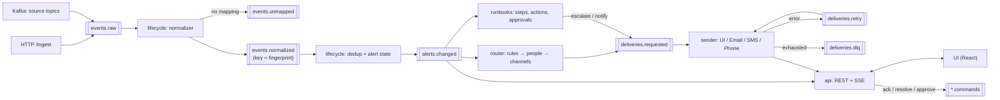

# Alerting Service

A flexible alerting service built with Rust, Kafka and Postgres. It ingests events in **any schema**, folds duplicates into a single alert with a counter, routes alerts to the right people on **their preferred channels**, and guides operators through **runbooks** whose risky actions require human approval. It scales horizontally and picks up configuration changes without a restart.

Task description: [`docs/exercise.md`](docs/exercise.md) · Architecture in depth: [`docs/ARCHITEKTURA.md`](docs/ARCHITEKTURA.md) (Polish) · Specification: [`openspec/specs/`](openspec/specs/)

## Quick start

Only Docker with Compose v2 is required (~4 GB RAM).

```bash
git clone https://github.com/Golden-Coders/gs-hack && cd gs-hack
make demo          # build + up + demo data and scenario
```

| What | Address |
|---|---|
| UI (operator console; login: `anna` / `jan` / `ola` / `piotr` / `tomek`, password `haslo`) | http://localhost:5173 |
| API (REST + SSE `/stream`, `Authorization: Bearer dev-token`) | http://localhost:8080 |
| HTTP ingest | http://localhost:8081/ingest |
| Mailpit (sent emails) | http://localhost:8025 |

Send your first event. Send it twice: the alert counter goes up instead of a new alert being created.

```bash
curl -X POST localhost:8081/ingest -H 'Content-Type: application/json' -d '{
  "format": "json", "schema": "workflow.v1",
  "payload": {"type": "WORKFLOW_FAILED", "workflowId": "WF-1", "workflowName": "order-settlement",
              "step": "validate-counterparty", "severity": "ERROR", "environment": "prod",
              "error": {"code": "TIMEOUT", "message": "Counterparty service did not respond in 5000 ms"}}}'
```

## Architecture



Each box is a separate binary (`crates/<name>`), each double-bordered box is a Kafka topic, and state and configuration live in Postgres.

**Key decisions:**

- **Scalability.** Every stage is a Kafka consumer group. Topics have 12 partitions, so each stage scales to 12 instances with no code changes. Dedup is partitioned by fingerprint: one fingerprint always lands on one instance, so no distributed locks are needed.
- **Single writer.** Only `lifecycle` changes alert state and only `runbooks` changes runbook state; everything else sends commands to `*.commands`. No races over state.
- **At-least-once with idempotency.** Offsets are committed after side effects are stored. Every side effect has an idempotency key (delivery `(alert, episode, person, channel)`, runbook step `(run, step, attempt)`, HTTP action with an `Idempotency-Key` header).
- **Flexibility without code.** A new event schema is a `mapping` file (JSONPath → alert fields + fingerprint), a new rule is YAML with conditions, a new action is YAML. An event with an unknown schema goes to `events.unmapped` and waits for a mapping; once one is added it is processed. Configuration lives in Postgres and propagates via `NOTIFY`, with no restart.
- **Channels and fallback.** Channels come from each person's preferences (e.g. `critical → sms` during working hours, `email` otherwise). Transient error: retries (1 s, 5 s, 30 s). Permanent error: next channel in the chain. Chain exhausted: DLQ. The UI is always the last fallback channel.
- **Runbooks with approval gates.** `*.yaml` is an automatic runbook (steps run in order; a step with `approval: required` or an action with `risk: high` waits for a human). `*.md` / `*.txt` is a manual runbook attached to notifications. An unknown action degrades to a manual step instead of breaking the runbook.

## Performance

Measured with `loadgen` (HTTP + Kafka, 3 schemas, 50% duplicates), 12 partitions, all services plus the load generator on one Docker Desktop VM (14 CPU, 4 GB RAM), so these are lower bounds. Every stage consumes Kafka concurrently (per-key lanes, offsets committed strictly in order after the handler succeeds). Methodology, scripts and full results: [`docs/LOADTEST.md`](docs/LOADTEST.md), [`loadtest/RESULTS.md`](loadtest/RESULTS.md).

| Setup | Sustained throughput | End-to-end latency (`delivered_at − received_at`) |
|---|---|---|
| 1 instance of each service, before concurrent consumers | 450 msg/s | seconds once saturated (p50 2.5 s at 500 msg/s) |
| 1 instance of each service, **now** | **1,500 msg/s** (2,000 borderline), 0 errors | p50 **12 ms**, p99 **187 ms** at 1,500 msg/s; p50 11 ms, p99 44 ms at 1,000 msg/s |
| lifecycle ×4, router ×4, sender ×2, runbooks ×2, ingest ×2 (HTTP) | 1,500 msg/s; normalizer alone reaches ~5,000 msg/s | bottleneck moves to `runbooks`, dedup and Postgres |
| Duplicate storm (`DUP_RATIO=1.0`, 3 hot fingerprints), scaled | 3,000 msg/s | lag ≤ 1,009, drains in 3.4 s |
| Rule evaluation (`crates/condition`) | ~93,000 events/s at 100 rules | ~10.8 µs / event |

Correctness holds in every run: the sum of alert counters equals the number of events sent, there are no duplicate `idempotency_key` rows, and all consumer lags return to zero. Under overload the system degrades by queueing, not by dropping events: ingest accepted 10,000 msg/s with no errors.

## Action safety

- Only actions from the registry are executed; an action with `risk: high` **always** requires approval, regardless of what the runbook says.
- The host of an HTTP action must be on `ACTION_HOST_ALLOWLIST`; redirects outside the list are blocked and response size is capped.
- Secrets in configuration are only `${ENV}` references; templates (`minijinja`) run in a sandbox with no access to files or environment variables.
- Audit: every alert and runbook step state change is written to a log (who, what, when, result).
- Authentication: operator sessions (PBKDF2 in Postgres, `POST /auth/login`), identity bound server-side.

## Extending

File formats are the types in `crates/contracts/src/config.rs`, with examples in [`config/`](config/README.md); everything is also editable from the UI.

| To add | How |
|---|---|
| a Kafka source | `config/sources/<name>.yaml` (`topic`, `schema`, `format`) |
| an event schema | `config/mappings/<schema>.yaml`, or click through an UNMAPPED event in the UI |
| a rule | `config/rules/<id>.yaml`: `condition` (all/any/not; `eq, ne, in, gt, gte, lt, lte, contains, regex, exists, glob`), `recipients`, `presentation` |
| a runbook action | `config/actions/<name>.yaml` (`kind: http`, `risk`, URL from the allowlist) |
| a runbook | `config/runbooks/*.yaml` (automatic) or `*.md` / `*.txt` (manual) |
| a delivery channel | one adapter implementing `ChannelAdapter` in `crates/sender`; retry, fallback, DLQ and idempotency are shared |

Optionally, a free-text runbook can be turned into steps by an LLM (`LLM_PROVIDER=local|api`, off by default in the product). Only the runbook description is sent to the model, after redacting URLs, IPs and hosts, and never any alert data. The action registry classifies the result and a human must always accept it.

## Repository layout

| Path | What |
|---|---|
| `crates/contracts`, `crates/common` | event, config and topic types, idempotency keys; Kafka, Postgres |
| `crates/ingest`, `crates/lifecycle` | event intake, normalization, dedup, alert lifecycle |
| `crates/condition`, `crates/router`, `crates/sender` | conditions and templates, routing, delivery |
| `crates/runbooks`, `crates/mock-targets` | runbook engine, action registry, fake services |
| `crates/api` | REST + SSE for the UI ([`contracts/openapi.yaml`](contracts/openapi.yaml)) |
| `crates/loadgen` | traffic generator and measurement scripts |
| `config/`, `migrations/` | configuration (seed + live editing), Postgres schema |
| `ui/` | operator console (React + Vite + TypeScript) |
| `scripts/e2e/` | end-to-end tests |

## Tests

```bash
cargo test --workspace                     # unit tests (some need a running Postgres)
scripts/e2e/first-flow.sh                  # first end-to-end flow
scripts/e2e/appendix-a.sh                  # 3 schemas + dedup of 500 + reopen
scripts/e2e/runbooks.sh                    # AUTOMATIC and MANUAL runbooks
scripts/e2e/resilience.sh                  # service restarts, channel fallback
```

## What is simulated

SMS and phone (mock), SMTP (Mailpit), and the services that runbook actions act on (`mock-targets`). Swapping in real providers: [`docs/MOCKS.md`](docs/MOCKS.md).

## Use of AI

- **Tools:** Claude Code with the OpenSpec workflow (propose, apply) for planning and implementation; requirements have scenarios that serve as test cases ([`openspec/`](openspec/)).
- **Oversight:** a human reviewed every change before merge; typecheck, clippy and tests had to pass. AI-generated code is subject to the same security rules as hand-written code.
- **Privacy:** only this repository's code and synthetic data from `crates/contracts/fixtures/` were sent to AI tools, never production data or real secrets.
