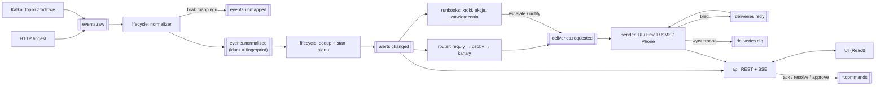

# Alerting Service

Elastyczny serwis alertingowy w Rust + Kafka + Postgres. Przyjmuje zdarzenia w **dowolnym schemacie**, skleja duplikaty w jeden alert z licznikiem, kieruje alerty do właściwych osób na **ich preferowanych kanałach** i prowadzi przez **runbooki** z akcjami, które wymagają zatwierdzenia człowieka. Całość skaluje się poziomo i działa bez restartu przy zmianie konfiguracji.

Treść zadania: [`docs/exercise.md`](docs/exercise.md) · Architektura od środka: [`docs/ARCHITEKTURA.md`](docs/ARCHITEKTURA.md) · Specyfikacja: [`openspec/specs/`](openspec/specs/)

## Uruchomienie

Wymagany tylko Docker z Compose v2 (~4 GB RAM).

```bash
git clone https://github.com/Golden-Coders/gs-hack && cd gs-hack
make demo          # build + up + dane i scenariusz demo
```

| Co | Adres |
|---|---|
| UI (konsola operatora, login: `anna`/`jan`/`ola`/`piotr`/`tomek`, hasło `haslo`) | http://localhost:5173 |
| API (REST + SSE `/stream`, `Authorization: Bearer dev-token`) | http://localhost:8080 |
| Ingest HTTP | http://localhost:8081/ingest |
| Mailpit (wysłane e-maile) | http://localhost:8025 |

Pierwsze zdarzenie (wyślij dwa razy: licznik alertu wzrośnie zamiast powstać nowy alert):

```bash
curl -X POST localhost:8081/ingest -H 'Content-Type: application/json' -d '{
  "format": "json", "schema": "workflow.v1",
  "payload": {"type": "WORKFLOW_FAILED", "workflowId": "WF-1", "workflowName": "order-settlement",
              "step": "validate-counterparty", "severity": "ERROR", "environment": "prod",
              "error": {"code": "TIMEOUT", "message": "Counterparty service did not respond in 5000 ms"}}}'
```

## Architektura



Każdy prostokąt to osobna binarka (`crates/<nazwa>`), każda podwójna ramka to topik Kafki, stan i konfiguracja są w Postgresie.

**Kluczowe decyzje:**

- **Skalowalność.** Każdy etap to grupa konsumentów Kafki; topiki mają 12 partycji, więc etap skaluje się do 12 instancji bez zmian w kodzie. Dedup jest partycjonowany po fingerprincie: jeden fingerprint trafia zawsze do jednej instancji, więc nie potrzeba rozproszonych blokad.
- **Single writer.** Stan alertu zmienia wyłącznie `lifecycle`, stan runbooka wyłącznie `runbooks`; reszta wysyła komendy na `*.commands`. Brak wyścigów o stan.
- **At-least-once + idempotencja.** Offset jest commitowany po zapisaniu skutków. Każdy skutek ma klucz idempotencji (dostarczenie `(alert, epizod, osoba, kanał)`, krok runbooka `(run, krok, próba)`, akcja HTTP z `Idempotency-Key`).
- **Elastyczność bez kodu.** Nowy schemat zdarzeń = plik `mapping` (JSONPath → pola alertu + fingerprint), nowa reguła = YAML z warunkami, nowa akcja = YAML. Zdarzenie nieznanego schematu trafia na `events.unmapped` i czeka na mapping, a po jego dodaniu zostaje przetworzone. Konfiguracja żyje w Postgresie i propaguje się przez `NOTIFY`, bez restartu.
- **Kanały i fallback.** Kanały wynikają z preferencji osób (np. `critical → sms` w godzinach pracy, poza nimi `email`). Błąd przejściowy: ponowienia (1 s, 5 s, 30 s); błąd trwały: następny kanał w łańcuchu; wyczerpany łańcuch: DLQ. UI jest zawsze ostatnim kanałem.
- **Runbooki z bramkami zatwierdzeń.** `*.yaml` = runbook automatyczny (kroki po kolei, krok `approval: required` lub akcja `risk: high` czeka na człowieka), `*.md`/`*.txt` = runbook ręczny dołączany do powiadomień. Nieznana akcja degraduje się do kroku ręcznego zamiast wywracać runbook.

## Wydajność

Zmierzone `loadgen` (HTTP + Kafka, 3 schematy, 50% duplikatów), 12 partycji, wszystkie serwisy w Dockerze na jednym laptopie. Metodyka, skrypty i pełne wyniki: [`docs/LOADTEST.md`](docs/LOADTEST.md).

| Konfiguracja | Przepustowość | Latencja e2e (`delivered_at − received_at`) | Max lag |
|---|---|---|---|
| 1 instancja każdego serwisu | 500 msg/s, 0 błędów | email p50 **9,5 ms**, p99 **20,9 ms** | 3 (`sender`) |
| `lifecycle` ×2, `sender` ×2 | 500 msg/s, 0 błędów | p50 17–123 ms, p99 186–235 ms (zależnie od kanału) | 28 (`sender`) |
| Ewaluacja reguł (`crates/condition`) | ~93 000 zdarzeń/s przy 100 regułach | ~10,8 µs / zdarzenie | n/d |

Dedup zweryfikowany liczbowo: suma liczników alertów rośnie dokładnie o liczbę wysłanych zdarzeń, bez duplikatów `idempotency_key`. Pomiar wcześniejszy ujawnił wąskie gardło w `sender` (lag ~10 tys.), które usunęło współbieżne przetwarzanie.

## Bezpieczeństwo akcji

- Wykonujemy wyłącznie akcje z rejestru; akcja `risk: high` **zawsze** wymaga zatwierdzenia, niezależnie od treści runbooka.
- Host akcji HTTP musi być na `ACTION_HOST_ALLOWLIST`; przekierowania poza listę są blokowane, rozmiar odpowiedzi ograniczony.
- Sekrety w konfiguracji tylko jako `${ENV}`; szablony (`minijinja`) w sandboxie bez dostępu do plików i zmiennych środowiskowych.
- Audyt: każda zmiana stanu alertu i kroku runbooka trafia do dziennika (kto, co, kiedy, wynik).
- Uwierzytelnianie: sesje operatorów (PBKDF2 w Postgresie, `POST /auth/login`), tożsamość wiązana po stronie serwera.

## Rozszerzanie

Formaty plików = typy z `crates/contracts/src/config.rs`, przykłady w [`config/`](config/README.md); wszystko też edytowalne z UI.

| Chcę dodać | Jak |
|---|---|
| źródło Kafki | `config/sources/<nazwa>.yaml` (`topic`, `schema`, `format`) |
| schemat zdarzeń | `config/mappings/<schema>.yaml` albo klik w UI na zdarzeniu UNMAPPED |
| regułę | `config/rules/<id>.yaml`: `condition` (all/any/not; `eq, ne, in, gt, gte, lt, lte, contains, regex, exists, glob`), `recipients`, `presentation` |
| akcję runbooka | `config/actions/<nazwa>.yaml` (`kind: http`, `risk`, URL z allowlisty) |
| runbook | `config/runbooks/*.yaml` (automatyczny) lub `*.md` / `*.txt` (ręczny) |
| kanał dostarczania | jeden adapter implementujący `ChannelAdapter` w `crates/sender`; retry, fallback, DLQ i idempotencja są wspólne |

Opcjonalnie runbook w wolnym tekście można zamienić na kroki przez LLM (`LLM_PROVIDER=local|api`, domyślnie wyłączone w produkcie). Do modelu trafia tylko opis runbooka po redakcji URL-i, IP i hostów, bez danych alertów; wynik klasyfikuje rejestr akcji i zawsze wymaga akceptacji człowieka.

## Struktura repo

| Ścieżka | Co |
|---|---|
| `crates/contracts`, `crates/common` | typy zdarzeń, konfiguracji, topiki, klucze idempotencji; Kafka, Postgres |
| `crates/ingest`, `crates/lifecycle` | przyjmowanie zdarzeń, normalizacja, dedup, cykl życia alertu |
| `crates/condition`, `crates/router`, `crates/sender` | warunki i szablony, routing, dostarczanie |
| `crates/runbooks`, `crates/mock-targets` | silnik runbooków, rejestr akcji, udawane usługi |
| `crates/api` | REST + SSE dla UI ([`contracts/openapi.yaml`](contracts/openapi.yaml)) |
| `crates/loadgen` | generator ruchu i skrypty pomiarowe |
| `config/`, `migrations/` | konfiguracja (seed + edycja na żywo), schemat Postgresa |
| `ui/` | konsola operatora (React + Vite + TypeScript) |
| `scripts/e2e/` | testy end-to-end |

## Testy

```bash
cargo test --workspace                     # testy jednostkowe (część wymaga działającego Postgresa)
scripts/e2e/first-flow.sh                  # pierwszy przepływ end-to-end
scripts/e2e/appendix-a.sh                  # 3 schematy + dedup 500 + reopen
scripts/e2e/runbooks.sh                    # runbooki AUTOMATIC i MANUAL
scripts/e2e/resilience.sh                  # restarty serwisów, fallback kanałów, DLQ
```

## Co jest symulowane

SMS i telefon (mock), SMTP (Mailpit), usługi, na których działają akcje runbooków (`mock-targets`). Podmiana na prawdziwych dostawców: [`docs/MOCKS.md`](docs/MOCKS.md).

## Użycie AI

- **Narzędzia:** Claude Code z workflow OpenSpec (propose, apply) do planowania i implementacji; wymagania mają scenariusze służące jako przypadki testowe ([`openspec/`](openspec/)).
- **Kontrola:** każdą zmianę przeglądał człowiek przed merge'em; typecheck, clippy i testy musiały przechodzić. Kod wygenerowany przez AI podlega tym samym regułom bezpieczeństwa co ręczny.
- **Prywatność:** do narzędzi AI trafiał wyłącznie kod repozytorium i syntetyczne dane z `crates/contracts/fixtures/`, bez danych produkcyjnych i prawdziwych sekretów.
