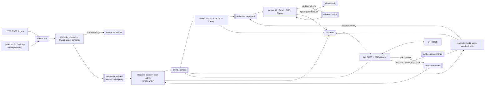

# Alerting Service

Serwis alertingowy: przyjmuje zdarzenia w dowolnym schemacie, skleja duplikaty w jeden alert z licznikiem, dopasowuje reguły zespołów, powiadamia właściwe osoby na preferowanych kanałach i prowadzi przez runbooki z akcjami, które wymagają zatwierdzenia człowieka.

Zadanie: [`docs/exercise.md`](docs/exercise.md). Plan i decyzje techniczne: [`openspec/changes/archive/2026-11-21-alerting-service-mvp/`](openspec/changes/archive/2026-11-21-alerting-service-mvp/) (`proposal.md`, `design.md`, `specs/`).

## Uruchomienie

Wymagania: Docker z Compose v2 (~4 GB RAM dla kontenerów). Nic więcej nie trzeba instalować.

```bash
git clone https://github.com/Golden-Coders/gs-hack && cd gs-hack
docker compose up --build      # albo: make demo (to samo + dane demo, patrz niżej)
```

To wszystko: dwie komendy (`git clone` + `docker compose up --build` lub `make demo`). Pierwsze budowanie backendu w Rust trwa kilka minut, kolejne starty kilkanaście sekund. Potem:

| Co | Adres |
|---|---|
| UI (konsola operatora) | http://localhost:5173 |
| API (REST + SSE `/stream`) | http://localhost:8080 (`Authorization: Bearer dev-token`) |
| Ingest HTTP | http://localhost:8081/ingest |
| Mailpit (podgląd wysłanych e-maili) | http://localhost:8025 |
| Kafka API (Redpanda) z hosta | `localhost:19092` |

**Demo.** `make demo` = `docker compose up -d --build` + generator scenariusza `scripts/demo/run.sh` (wysyła zdarzenia pokazujące deduplikację, routing, fallback i runbooki). `make down` zatrzymuje stack. Scenariusz nagrania: [`docs/DEMO.md`](docs/DEMO.md). Pomiar obciążenia: [`docs/LOADTEST.md`](docs/LOADTEST.md).

**Tokeny i porty.** API wymaga nagłówka `Authorization: Bearer dev-token` (dla SSE `/stream` także `?token=dev-token`, bo `EventSource` nie ustawia nagłówków); zmiany stanu wymagają ponadto `X-Person-Id`. Ingest (`:8081`) jest bez tokenu. Port 8080 zajęty? `API_PORT=8088 docker compose up --build` (albo `API_PORT=8088 make demo`).

Pierwsze zdarzenie:

```bash
curl -X POST localhost:8081/ingest -H 'Content-Type: application/json' -d '{
  "format": "json", "schema": "workflow.v1",
  "payload": {"type": "WORKFLOW_FAILED", "workflowId": "WF-1", "workflowName": "order-settlement",
              "step": "validate-counterparty", "severity": "ERROR", "environment": "prod",
              "error": {"code": "TIMEOUT", "message": "Counterparty service did not respond in 5000 ms"}}}'
```

Alert pojawia się w feedzie UI bez odświeżania strony. Wyślij to samo jeszcze raz, a licznik alertu wzrośnie zamiast tworzyć nowy alert.

## Architektura



Każdy prostokąt to osobna binarka Rust (`crates/<nazwa>`), każda podwójna ramka to topik Kafki. Stan i konfiguracja są w Postgresie.

- **Skalowanie poziome.** Każdy etap to grupa konsumentów Kafki. Topiki mają 12 partycji, więc każdy etap da się uruchomić w maksymalnie 12 instancjach bez zmian w kodzie. Dedup jest partycjonowany po fingerprincie, więc jeden fingerprint zawsze trafia do jednej instancji i deduplikacja nie potrzebuje rozproszonej blokady.
- **Single writer.** Stan alertu zmienia tylko `lifecycle`, a stan runbooka tylko `runbooks`. UI i inne etapy wysyłają komendy na topiki `*.commands`.
- **At-least-once i idempotencja.** Offset jest commitowany po zapisaniu skutków. Każdy skutek uboczny ma klucz idempotencji: dostarczenie `(alert, epizod, osoba, kanał)`, krok runbooka `(run, krok, próba)`, a akcja HTTP dostaje nagłówek `Idempotency-Key`.
- **Konfiguracja bez restartu.** Pliki w `config/` to seed i alternatywny edytor. Źródłem prawdy w runtime jest Postgres, a zmiany rozchodzą się przez `NOTIFY`. Zmiana z UI, API albo pliku działa od razu.
- **Bez wąskiego gardła na ścieżce alertu.** Router i runbooki działają równolegle na `alerts.changed`, a sender nie zna reguł: dostaje gotowy łańcuch kanałów zapasowych.

Pełne uzasadnienia: `design.md`, decyzje D1–D15. Pomiar przepustowości i latencji: [`docs/LOADTEST.md`](docs/LOADTEST.md).

## Jak to rozszerzyć

Wszystkie poniższe zmiany to konfiguracja albo jeden plik kodu. Format każdego pliku = typy z `crates/contracts/src/config.rs`, przykłady w `crates/contracts/fixtures/config/`, opis katalogów w [`config/README.md`](config/README.md).

### Nowe źródło (Kafka)

Dodaj plik `config/sources/<nazwa>.yaml`:

```yaml
topic: trades            # topik, z którego czytamy
schema: trade.rejected.v2
format: json             # json albo yaml
```

Zdarzenia HTTP nie wymagają konfiguracji: `POST /ingest` z kopertą `{format, schema, payload}` albo `POST /ingest/{schema}` z samym payloadem.

### Nowy schemat zdarzeń

Najszybciej z UI. W **Mappingi** zdarzenia nieznanego schematu czekają jako **UNMAPPED** razem z przykładowym payloadem. Klikasz pola w payloadzie, wybierasz severity, fingerprint i warunek „rozwiązany”, patrzysz na podgląd i zapisujesz. Zaległe zdarzenia zostają przetworzone i trafiają do feedu.

Albo plikiem `config/mappings/<schema>.yaml`:

```yaml
schema: workflow.v1
fields: { workflowName: $.workflowName, step: $.step, environment: $.environment }
title: $.error.message
severity: { type: path, path: $.severity, map: { ERROR: error, CRITICAL: critical }, default: warning }
fingerprint: [$.workflowName, $.step, $.error.code]   # te same wartości = ten sam alert z licznikiem
```

### Nowa reguła

W UI: **Reguły → Nowa reguła**. Kreator warunków (wszystkie / dowolny / nie, operatory słowami) jest zsynchronizowany z YAML. Ustawiasz w nim odbiorców, wygląd alertu (szablony tytułu i treści, wyróżnione pola, kolor) i sprawdzasz regułę przyciskiem „testuj na zdarzeniu”, który pokazuje, który warunek pasował. Albo plikiem `config/rules/<id>.yaml`:

```yaml
id: settlements-prod
name: "Settlements: failed settlement workflows in prod"
condition:
  all:
    - { field: raw.type, op: eq, value: WORKFLOW_FAILED }
    - { field: raw.workflowName, op: eq, value: order-settlement }
    - { field: raw.environment, op: eq, value: prod }
recipients: [{ type: team, id: settlements }]   # KTO; kanały wynikają z preferencji osób
presentation:
  title: "{{raw.type}} {{raw.workflowName}}"
  body: "Step {{raw.step}} failed: {{raw.error.message}}"
  fields: [raw.workflowId, raw.step, raw.error.message]
  highlight: { raw.step: red, raw.error.message: red }
```

Operatory: `eq, ne, in, gt, gte, lt, lte, contains, regex, exists, glob`.

**Kanały** wynikają z preferencji osoby (`config/people.yaml`), np. `critical → sms` w godzinach 08:00–20:00, w pozostałych godzinach `email`. Preferencje zespołu są domyślne dla jego członków. UI jest zawsze ostatnim kanałem zapasowym.

### Nowy kanał

Jeden adapter w `crates/sender` implementujący `ChannelAdapter` (`kind()`, `send(&Rendered) -> Result<ProviderRef, SendError>`). Błąd `Transient` uruchamia ponawianie (1 s, 5 s, 30 s), a `Permanent` od razu przechodzi do następnego kanału. Retry, fallback, DLQ, idempotencja i statusy działają w senderze wspólnie dla wszystkich kanałów, więc adapter tylko wysyła. Wymianę mocków na prawdziwych dostawców opisuje [`docs/MOCKS.md`](docs/MOCKS.md).

### Nowa akcja runbooka

W UI: **Akcje**. Lista „brakujące akcje” pokazuje akcje użyte w runbookach, których nie ma w rejestrze. Klikasz „Dodaj”, wypełniasz formularz akcji HTTP i zapisujesz. Albo plikiem `config/actions/<nazwa>.yaml`:

```yaml
name: flush_cache
kind: http
risk: low                      # high = zawsze wymaga zatwierdzenia w UI
http:
  method: POST
  url: "http://mock-targets:8090/cache/{{service}}/flush"   # host musi być na ACTION_HOST_ALLOWLIST
  headers: { Authorization: "Bearer ${CACHE_ADMIN_TOKEN}" } # sekrety tylko jako ${ENV}
  timeout_ms: 5000
```

Akcje wymagające kodu (np. `escalate`, `notify`) to jedna implementacja `Action` w `crates/runbooks`.

### Nowy runbook

Plik w `config/runbooks/`:
- `*.yaml` to runbook **automatyczny**: kroki wykonywane po kolei, start raz na epizod alertu. Krok z `approval: required` albo akcja `risk: high` czeka na zatwierdzenie w **Zatwierdzeniach**. Błąd zatrzymuje runbook, a w UI można kliknąć „ponów”, „pomiń” albo „tryb ręczny”. Nieznana akcja staje się krokiem ręcznym i pojawia się na liście brakujących akcji.
- `*.md` albo `*.txt` to runbook **ręczny**: Markdown lub wolny tekst dołączany do powiadomień (pełna treść w UI i e-mailu, link w SMS).

## UI: skróty klawiszowe

Jednoklawiszowe skróty działają w feedzie alertów i w kolejce zatwierdzeń, ale nie w polach tekstowych, listach wyboru ani oknach dialogowych (litera trafia do pola).

| Skrót | Gdzie | Działanie |
|---|---|---|
| `j` / `↓` | feed alertów, kolejka zatwierdzeń | następny wiersz |
| `k` / `↑` | feed alertów, kolejka zatwierdzeń | poprzedni wiersz |
| `Enter` | feed alertów, kolejka zatwierdzeń | otwórz alert bieżącego wiersza (gdy fokus nie jest na linku ani przycisku) |
| `Escape` | feed alertów, kolejka zatwierdzeń | wyczyść bieżący wiersz i zaznaczenie |
| `x` | kolejka zatwierdzeń | zaznacz / odznacz bieżący krok do akcji zbiorczej |
| `a` | kolejka zatwierdzeń | zatwierdź bieżący krok (wymaga wybranej tożsamości „działam jako”) |
| `r` | kolejka zatwierdzeń | odrzuć bieżący krok — najpierw okno potwierdzenia |
| `⌘K` / `Ctrl+K` | każdy ekran | paleta komend: przejście do ekranu lub alertu po tytule; `Escape` zamyka |

Akcje zbiorcze (pasek nad listą po zaznaczeniu kroków) wysyłają komendy po kolei, a wynik raportują per krok; odrzucenie zbiorcze pyta o potwierdzenie z liczbą kroków. Zatwierdzenia nie da się cofnąć, a powód odrzucenia nie jest zapisywany (API tego nie wspiera).

## Struktura repo

| Ścieżka | Co |
|---|---|
| `crates/contracts`, `crates/common` | wspólne typy zdarzeń, konfiguracji i topików; Kafka, Postgres, env |
| `crates/ingest`, `crates/lifecycle` | przyjmowanie zdarzeń, normalizacja, dedup, cykl życia alertu |
| `crates/condition`, `crates/router`, `crates/sender` | warunki i szablony, routing, dostarczanie |
| `crates/runbooks`, `crates/mock-targets` | runbooki, rejestr akcji, udawane usługi dla akcji |
| `crates/api` | gateway REST + SSE dla UI ([`contracts/openapi.yaml`](contracts/openapi.yaml)) |
| `crates/loadgen` | generator ruchu do testu obciążenia |
| `ui/` | konsola operatora (React + Vite + TypeScript) |
| `config/` | konfiguracja: seed + edycja na żywo |
| `migrations/` | schemat Postgresa (prefiks = strumień-właściciel) |

Praca lokalna bez Dockera dla binarek: `docker compose up -d redpanda postgres mailpit topics-init`, potem `cargo run -p <binarka>`. UI na mocku API: `cd ui && npm install && npm run mock` oraz `npm run dev` (w UI można przełączyć backend: mock albo prawdziwy).

## Co jest symulowane

SMS i telefon, serwer SMTP (Mailpit), usługi, na których działają akcje runbooków (`mock-targets`), logowanie (statyczny token + wybór „działam jako” w UI). Szczegóły i sposób podmiany na prawdziwe: [`docs/MOCKS.md`](docs/MOCKS.md).

## Bezpieczeństwo

- **Akcje.** Wykonujemy tylko akcje z rejestru. Akcja `risk: high` zawsze wymaga zatwierdzenia człowieka w UI, niezależnie od treści runbooka. Host akcji HTTP musi być na `ACTION_HOST_ALLOWLIST`. Przekierowania na inne hosty są blokowane, a rozmiar odpowiedzi ograniczony. Nieznana akcja nigdy się nie wykona: staje się krokiem ręcznym.
- **Sekrety** w konfiguracji akcji są wyłącznie referencjami `${ENV_NAME}`, rozwijanymi w runtime. Formularz w UI ostrzega, gdy wartość nagłówka wygląda na wklejony sekret.
- **Szablony** (`minijinja`) nie mają dostępu do plików ani zmiennych środowiskowych, a rozmiar wyniku jest ograniczony.
- **Treść z konfiguracji w UI:** Markdown runbooków renderujemy bez surowego HTML i z czyszczeniem linków (`javascript:`). Kolory z reguł przechodzą przez stałą paletę, więc reguła nie wstrzyknie CSS.
- **Audyt:** każda zmiana stanu alertu i kroku runbooka trafia do dziennika (kto, co, kiedy, wynik), widocznego w szczegółach alertu.
- **Ograniczenia MVP:** uwierzytelnianie to statyczny token API plus wybór tożsamości w UI, bez prawdziwego logowania i ról. Na produkcji: SSO/OIDC i autoryzacja per zespół.

## Użycie AI

- **Narzędzia:** zespół użył agentów Claude Code z workflow OpenSpec (propose, apply, każdy strumień w osobnym worktree) do planowania i implementacji.
- **Planowanie:** wymagania, decyzje techniczne i zadania powstały jako change [OpenSpec](openspec/changes/archive/2026-11-21-alerting-service-mvp/) z pomocą Claude Code. Każde wymaganie ma scenariusze, które służą jako przypadki testowe, a każde zadanie ma kryterium weryfikacji.
- **Implementacja:** Claude Code pracował w strumieniach z jawną własnością katalogów ([`CLAUDE.md`](CLAUDE.md)). Agent edytuje tylko katalogi swojego strumienia, a kontrakty (`crates/contracts`, `contracts/openapi.yaml`) są zamrożone i zmieniane wyłącznie addytywnie po uzgodnieniu z zespołem. Część ekranów UI zbudowali równolegle subagenci w osobnych worktree. Każdą zmianę przeglądał człowiek przed merge'em, a typecheck i testy crate'ów musiały przechodzić.
- **Bezpieczeństwo i prywatność:** do narzędzi AI trafiały wyłącznie kod tego repozytorium i syntetyczne dane z `crates/contracts/fixtures/`, bez danych produkcyjnych, klientów ani prawdziwych sekretów (jedyny token to `dev-token`). Kod wygenerowany przez AI przechodził te same reguły co ręczny: allowlista hostów, approval dla `risk: high`, brak sekretów w plikach.
- **AI w produkcie:** w MVP nie ma wywołań LLM. Jest tylko interfejs `RunbookAuthor` z implementacją `none`, przygotowany pod tworzenie runbooków z opisu. Zasady na przyszłość (design D12): do modelu trafia tylko opis runbooka po redakcji hostów, IP, e-maili i URL, nigdy dane alertów. Odpowiedź jest ograniczona schematem z akcjami z rejestru, a wynik zawsze wymaga akceptacji człowieka.
