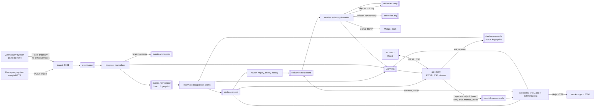
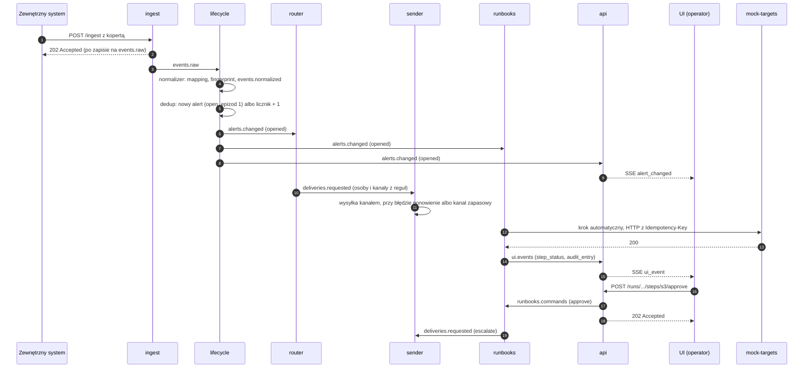
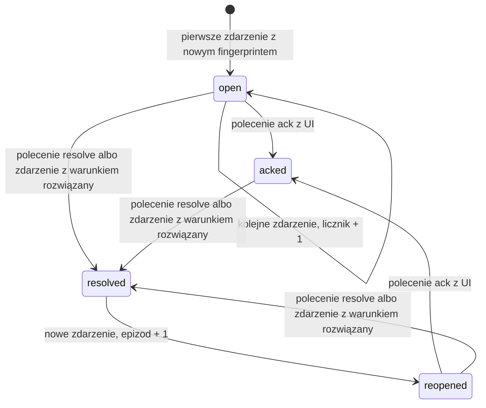
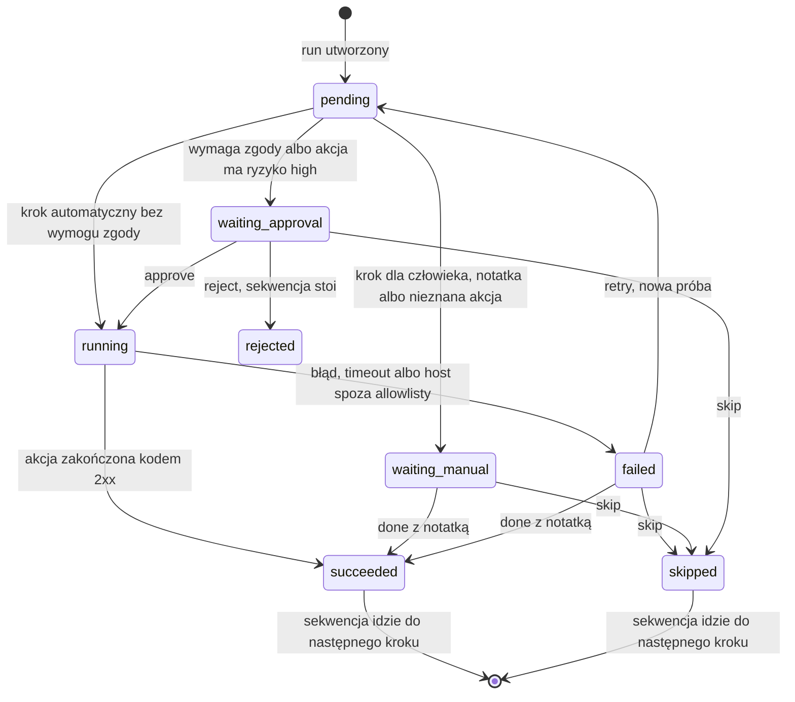
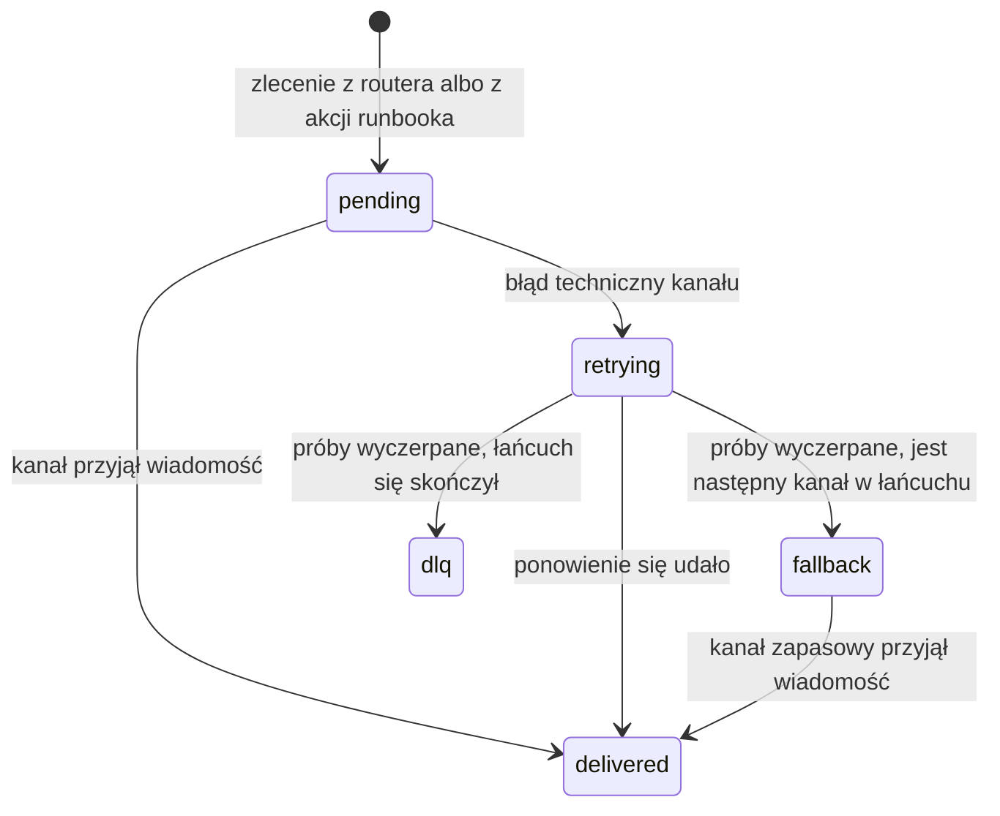
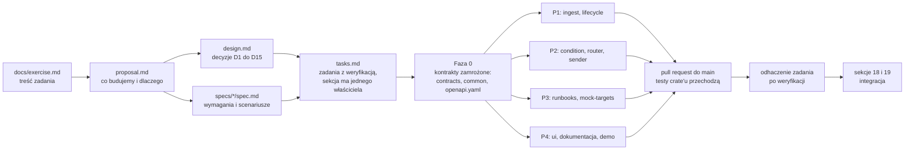

# Alerting Service od środka

Ten dokument opisuje kod, który jest w repozytorium, a nie tylko plan. Stan: gałąź `main` po scaleniu pull requesta nr 31 (21 listopada 2026). Każde pojęcie jest zdefiniowane w sekcji [Pojęcia](#2-pojęcia), zanim zostanie użyte dalej.

**Co robi system.** Inne systemy firmy wysyłają do niego zdarzenia, na przykład „workflow rozliczenia WF-42 przekroczył czas oczekiwania”. Zdarzenia mogą mieć dowolny kształt. System sprowadza każde zdarzenie do jednego wspólnego kształtu, łączy powtórzenia tego samego problemu w jeden alert z licznikiem, sprawdza reguły zespołów, powiadamia właściwe osoby kanałem, który te osoby wybrały, i prowadzi operatora przez runbook, czyli instrukcję naprawy. Część kroków runbooka system wykonuje sam, a ryzykowne kroki wykonuje dopiero po zatwierdzeniu przez człowieka.

Spis treści:
1. [Stan prac](#1-stan-prac)
2. [Pojęcia](#2-pojęcia)
3. [Mapa systemu](#3-mapa-systemu)
4. [Droga jednego zdarzenia, krok po kroku](#4-droga-jednego-zdarzenia-krok-po-kroku)
5. [Automaty stanów](#5-automaty-stanów)
6. [Komponenty](#6-komponenty)
7. [Topiki Kafki](#7-topiki-kafki)
8. [Tabele Postgresa](#8-tabele-postgresa)
9. [Technologie](#9-technologie)
10. [Zasady, które trzymają system w całości](#10-zasady-które-trzymają-system-w-całości)
11. [Jak pracuje zespół](#11-jak-pracuje-zespół)
12. [Co zostało do zrobienia](#12-co-zostało-do-zrobienia)

---

## 1. Stan prac

Liczby to zadania odhaczone w `openspec/changes/alerting-service-mvp/tasks.md`. Zadanie odhacza się dopiero wtedy, gdy przeszła opisana przy nim weryfikacja.

| Strumień | Osoba | Sekcje | Zrobione |
|---|---|---|---|
| Faza 0: kontrakty i szkielet | wszyscy | 1 | 9 z 9 |
| P1: ingest i cykl życia alertu | Krzysztof Jet | 2–5 | 16 z 17 |
| P2: reguły, routing, dostarczanie | Krzysztof Wojt | 6–9 | 14 z 14 |
| P3: runbooki i akcje | Kostek | 10–12 | 12 z 12 |
| P4: interfejs, dokumentacja, demo | Damian | 13–17 | 7 z 15 |
| Integracja od początku do końca | wszyscy | 18 | 2 z 6 |
| Pipeline P1+P2 (dokończenie integracji) | Krzysztof Jet, Krzysztof Wojt | 19 | 9 z 14 |

Cały kod przepływu jest napisany i działa: od przyjęcia zdarzenia, przez alert, reguły, powiadomienia i runbooki, aż po zmiany na żywo w interfejsie. Brakujące zadania to w większości weryfikacje na czystym klonie, testy odporności i skalowania oraz pomiar wydajności. Szczegóły są w sekcji [12](#12-co-zostało-do-zrobienia).

---

## 2. Pojęcia

Angielska nazwa w nawiasie to nazwa używana w kodzie.

### Dziedzina: zdarzenia i alerty

| Pojęcie | Znaczenie |
|---|---|
| **Zdarzenie** (event) | Jedna wiadomość od zewnętrznego systemu, na przykład informacja, że workflow się nie powiódł. System nie narzuca kształtu zdarzenia. |
| **Koperta** (envelope) | Obiekt JSON z trzema polami. `format` mówi, jak zapisana jest treść (`json` albo `yaml`). `schema` mówi, jakiego rodzaju jest zdarzenie (na przykład `workflow.v1`). `payload` to sama treść. Pole `format` nie oznacza rodzaju zdarzenia. |
| **Schemat** (schema) | Nazwa rodzaju zdarzenia. Każdy schemat ma własny mapping. |
| **Mapping** | Konfiguracja dla jednego schematu. Mówi, które pola wyciągnąć z treści zdarzenia, jak ustalić poziom ważności (severity), tytuł i fingerprint oraz kiedy zdarzenie oznacza „problem rozwiązany”. Ścieżki do pól są zapisane w języku JSONPath, na przykład `$.error.code`. |
| **Zdarzenie kanoniczne** (CanonicalEvent) | Zdarzenie po zastosowaniu mappingu. Ma jeden wspólny kształt niezależnie od źródła, a oryginalna treść jest zachowana w polu `raw`. |
| **Zdarzenie UNMAPPED** | Zdarzenie, dla którego schematu nie ma jeszcze mappingu. System go nie odrzuca. Zapisuje je w bazie, a gdy ktoś doda mapping, przetwarza je ponownie. |
| **Fingerprint** | Tekst zbudowany z wybranych pól zdarzenia (wyboru dokonuje mapping), na przykład `workflow.v1\|order-settlement\|validate-counterparty\|TIMEOUT`. Dwa zdarzenia o tym samym fingerprincie są traktowane jako ten sam problem. |
| **Alert** | Jeden rekord na jeden fingerprint w tabeli `alerts`. Ma stan (`open`, `acked`, `resolved`, `reopened`) i licznik zdarzeń. |
| **Deduplikacja** (dedup) | Gdy przychodzi zdarzenie z fingerprintem, który ma już otwarty alert, system nie tworzy nowego alertu, tylko zwiększa licznik istniejącego. Pięćset identycznych błędów daje jeden alert z licznikiem 500 i jedno powiadomienie na odbiorcę. |
| **Epizod** (episode) | Numer kolejnego otwarcia tego samego alertu. Gdy alert był rozwiązany, a problem wraca, system otwiera ponownie ten sam alert i zwiększa numer epizodu o 1. Runbook uruchamia się raz na epizod, a powiadomienia wychodzą ponownie. |
| **Ack** (acknowledge) | Potwierdzenie przez człowieka, że zajmuje się alertem. Zmienia stan alertu na `acked`. |
| **Reguła** (rule) | Warunek na polach alertu, lista odbiorców (osoby albo zespoły) i wygląd powiadomienia. Reguła mówi, kogo powiadomić, ale nie mówi, jakim kanałem. Może też podnieść severity (`severity_override`). |
| **Kanał** (channel) | Sposób dostarczenia powiadomienia: interfejs użytkownika (UI), e-mail, SMS albo telefon. Kanał wynika z preferencji osoby (zespół ma preferencje domyślne), które mogą zależeć od severity i godzin. UI jest zawsze ostatnim kanałem zapasowym. |
| **Łańcuch kanałów** (chain) | Kolejność kanałów dla jednego powiadomienia: najpierw kanał podstawowy, potem zapasowe osoby, na końcu UI. Gdy kanał zawiedzie technicznie, sender przechodzi do następnego. |

### Dziedzina: runbooki

| Pojęcie | Znaczenie |
|---|---|
| **Runbook** | Instrukcja rozwiązania problemu. Runbook **AUTOMATIC** (plik YAML) to lista kroków, które system wykonuje po kolei. Runbook **MANUAL** (plik Markdown albo tekstowy) to tekst dla człowieka: jest widoczny przy alercie, a router dołącza go do powiadomień (pełna treść w e-mailu i UI, link w SMS). |
| **Krok** (step) | Jeden element runbooka AUTOMATIC. Rodzaje: `check` (sprawdzenie), `action` (akcja), `manual` (czynność dla człowieka), `note` (notatka, na przykład warunek „jeśli ponowienie zawiedzie dwa razy”, którego system nie ocenia sam). |
| **Akcja** (action) | Operacja, którą system potrafi wykonać, zapisana w rejestrze akcji. Akcje wbudowane są w kodzie: `http_get` (sprawdzenie adresu), `escalate` (powiadomienie zespołu), `notify` (powiadomienie wskazanych osób). Akcje deklaratywne to wywołania HTTP opisane w pliku YAML albo dodane w UI. Krok z akcją spoza rejestru staje się krokiem manualnym. |
| **Ryzyko akcji** (risk) | `low` albo `high`. Akcja `high` zawsze wymaga zatwierdzenia, nawet jeśli runbook mówi inaczej. |
| **Run** | Jedno uruchomienie jednego runbooka dla jednego alertu w jednym epizodzie. Przechowuje kopię kroków z wartościami podstawionymi z alertu. |
| **Próba** (attempt) | Numer wykonania danego kroku w danym runie, od 0. Polecenie „ponów” tworzy nową próbę. |
| **Zatwierdzenie** (approval) | Decyzja człowieka w UI („zatwierdź” albo „odrzuć”) podejmowana przed wykonaniem kroku wymagającego zgody. |
| **Przypięcie do reguły** (`rule_ids`) | Runbook może wskazać reguły. Wtedy pasuje do każdego alertu, do którego pasuje któraś z tych reguł, niezależnie od własnego warunku `matches`. |

### Pojęcia techniczne

| Pojęcie | Znaczenie |
|---|---|
| **Crate i binarka** | Crate to pakiet kodu w języku Rust. Binarka to osobny program zbudowany z crate'a. W repozytorium każdy etap przetwarzania jest osobną binarką. |
| **Topik Kafki** (topic) | Nazwana, trwała kolejka wiadomości. Program-producent dopisuje wiadomości na koniec, a program-konsument czyta je po kolei. Wiadomości są zapisane na dysku, więc awaria konsumenta ich nie kasuje. |
| **Partycja i klucz** | Każdy topik jest podzielony na 12 partycji. Każda wiadomość ma klucz (na przykład fingerprint). Wiadomości o tym samym kluczu zawsze trafiają do tej samej partycji, a więc do tej samej instancji konsumenta, i są czytane w kolejności wysłania. |
| **Grupa konsumentów** (consumer group) | Zbiór instancji jednego programu, które dzielą między siebie partycje topiku. Uruchomienie drugiej instancji przenosi na nią część partycji, więc praca dzieli się na dwa procesy. Przy 12 partycjach etap może mieć najwyżej 12 instancji. |
| **Offset i commit** | Offset to numer wiadomości w partycji. Commit offsetu to zapis w Kafce „wiadomości do tego numeru mam obsłużone”. Po restarcie konsument zaczyna od pierwszej wiadomości po zatwierdzonym offsecie. |
| **At-least-once** (co najmniej raz) | Konsument zatwierdza offset dopiero po zapisaniu skutków pracy. Jeśli program przerwie pracę przed commitem, po restarcie przeczyta tę samą wiadomość ponownie. Skutek: żadna wiadomość nie ginie, ale ta sama wiadomość może zostać obsłużona dwa razy. |
| **Idempotencja** | Właściwość operacji: wykonanie jej drugi raz nie zmienia wyniku. Jest potrzebna, bo przy at-least-once wiadomości mogą przyjść podwójnie. Każdy skutek uboczny ma klucz (plik `crates/contracts/src/keys.rs`), a baza ma ograniczenie `UNIQUE` na ten klucz, więc drugi zapis niczego nie dubluje. |
| **Single writer** (jeden pisarz) | Stan danego obiektu zmienia tylko jeden program. Stan alertu zmienia tylko `lifecycle`, stan runa tylko `runbooks`. Pozostałe programy, w tym interfejs, wysyłają polecenia na topik `*.commands`. |
| **Hot reload** | Zmiana konfiguracji (mappingu, reguły, runbooka, akcji) zaczyna działać bez restartu programu. |
| **Migracja** | Plik SQL w katalogu `migrations/`, który tworzy albo zmienia tabele. Każda binarka uruchamia brakujące migracje przy starcie. Numer w nazwie mówi o właścicielu: 1xxx to P1, 2xxx to P2, 3xxx to P3. |
| **REST i SSE** | REST (Representational State Transfer) to styl API: zasoby pod adresami URL i metody HTTP (GET, POST, PUT, DELETE). SSE (Server-Sent Events) to stałe połączenie HTTP, którym serwer wysyła przeglądarce kolejne zdarzenia bez pytania o nie. |
| **DLQ** (dead letter queue) | Topik na wiadomości, których nie udało się dostarczyć żadnym kanałem mimo ponowień, żeby nie zginęły i żeby człowiek mógł je obejrzeć i wysłać ponownie. |

---

## 3. Mapa systemu

Prostokąt to program (binarka). Prostokąt z podwójnymi bokami to topik Kafki. Strzałka pokazuje, kto do czego pisze albo z czego czyta. Postgres pominąłem na tym grafie, żeby nie zasłaniał przepływu; tabele są w sekcji [8](#8-tabele-postgresa). Biblioteka `condition` (warunki i szablony) jest używana przez `lifecycle`, `router`, `runbooks` i `api`, ale nie ma jej na grafie, bo nie jest osobnym programem.

**Jak czytać ten graf.** Zdarzenie wchodzi z lewej strony (przez HTTP albo przez Kafkę) i staje się alertem w `lifecycle`. Każda zmiana stanu alertu trafia na topik `alerts.changed`, który czytają równolegle trzy programy: `router` (powiadomienia), `runbooks` (instrukcje naprawy) i `api` (przekazanie zmiany do przeglądarki). Ani `router`, ani `runbooks` nie czeka na drugi. Powiadomienia z reguł i z akcji `escalate`/`notify` idą jedną drogą przez `sender`. Człowiek w interfejsie nigdy nie zmienia stanu bezpośrednio: `api` zamienia jego kliknięcia na polecenia na topikach `*.commands`.

---

## 4. Droga jednego zdarzenia, krok po kroku

Przykład z pliku README: workflow `order-settlement` kończy się błędem `TIMEOUT`. Numeracja oddaje rzeczywistą kolejność. Najpierw diagram sekwencji, potem opis każdego kroku.

1. **Zewnętrzny system wysyła zdarzenie.** `POST http://localhost:8081/ingest` z kopertą `{format, schema, payload}`. Drugi wariant to `POST /ingest/{schema}` z samą treścią. Trzeci to zapis do topiku Kafki opisanego plikiem w `config/p1/sources/`. Ingest nie wymaga tokenu.
   *Kod:* `crates/ingest/src/http.rs`, `crates/ingest/src/sources.rs`. *Technologia:* axum, rdkafka.

2. **ingest przyjmuje zdarzenie.** Sprawdza, czy `format` to `json` albo `yaml` i czy treść jest poprawna. Nadaje zdarzeniu identyfikator `event_id` (UUID) oraz czas przyjęcia `received_at`, od którego liczy się opóźnienie całego przetwarzania. Publikuje kopertę na `events.raw` i dopiero po potwierdzeniu zapisu przez Kafkę odpowiada `202 Accepted`. Zły format daje odpowiedź 415, zła treść 400, niedostępna Kafka 503. Błędne wiadomości z topików źródłowych trafiają do tabeli `ingest_errors`. Katalog źródeł ingest sprawdza co 2 sekundy i bez restartu uruchamia albo zatrzymuje konsumentów. Brakujący topik źródłowy zakłada sam.
   *Kod:* `crates/ingest/src/lib.rs`.

3. **lifecycle normalizuje zdarzenie.** Rola „normalizer” czyta `events.raw` i szuka w pamięci mappingu dla pola `schema`. Jeśli mappingu nie ma, zapisuje zdarzenie w tabeli `unmapped_events`, publikuje je na `events.unmapped` i informuje interfejs. Jeśli mapping jest, wyciąga pola ścieżkami JSONPath, ustala severity (także z warunków), tytuł, fingerprint i warunek „rozwiązany”, a wynik (zdarzenie kanoniczne) publikuje na `events.normalized` z kluczem równym fingerprintowi.
   *Kod:* `crates/lifecycle/src/normalizer.rs`, `mapping.rs`, `config.rs`.

4. **lifecycle łączy duplikaty i zmienia stan alertu.** Rola „dedup” czyta `events.normalized` i `alerts.commands`. Oba topiki mają klucz równy fingerprintowi, więc wszystkie zdarzenia i polecenia dotyczące jednego problemu trafiają do jednej instancji programu. Ta instancja jest jedynym pisarzem tego alertu. Możliwe są cztery przypadki:
   - Fingerprintu nie ma w bazie: tworzy alert w stanie `open` z epizodem 1, zapisuje go od razu w tabelach `alerts` i `alert_episodes`, a potem publikuje `alerts.changed` z przejściem `opened`.
   - Alert jest otwarty: zwiększa licznik tylko w pamięci. Co około sekundę zapisuje przyrost licznika do bazy i wysyła `ui.events` z nowym licznikiem. Nie publikuje `alerts.changed`, więc duplikat nie wywołuje nowego powiadomienia.
   - Zdarzenie spełnia warunek „rozwiązany” z mappingu: zamyka alert (`resolved`).
   - Alert jest rozwiązany, a przychodzi nowe zdarzenie: otwiera ten sam alert ponownie, zwiększa epizod o 1 i publikuje `reopened`.

   *Kod:* `crates/lifecycle/src/dedup.rs`. *Tabele:* `alerts`, `alert_episodes`.

5. **router wybiera odbiorców i kanały.** Reaguje na `opened` i `reopened`. Ocenia warunki wszystkich włączonych reguł. Dla każdej pasującej reguły rozwija odbiorców (zespół zamienia na jego członków), dla każdej osoby wybiera kanał według jej preferencji, severity i godzin (preferencje zespołu są domyślne), buduje łańcuch kanałów zakończony UI i renderuje treść dla każdego kanału. Dołącza runbooki MANUAL pasujące do alertu: pełną treść w e-mailu i UI, link do alertu w SMS. Publikuje gotowe zlecenia na `deliveries.requested`. Ta sama osoba na tym samym kanale dostaje jedno zlecenie, nawet jeśli pasują dwie reguły.
   *Kod:* `crates/router/src/engine.rs` (funkcja `route_alert`), `config.rs`.

6. **sender wysyła powiadomienia.** Dla każdego zlecenia sprawdza klucz idempotencji (alert, epizod, osoba, kanał), żeby nie wysłać drugi raz. Wysyła adapterem kanału: e-mail przez SMTP do Mailpit, SMS i telefon do symulowanej skrzynki (tabela `mock_outbox`), a kanał UI oznacza jako dostarczony, bo powiadomienie widać w interfejsie przy alercie. Przy błędzie technicznym ponawia z opóźnieniem 1 s, 5 s, 30 s (maksymalnie 3 próby, konfigurowalne). Po wyczerpaniu prób przechodzi do następnego kanału w łańcuchu, a gdy łańcuch się skończy, zapisuje zlecenie na `deliveries.dlq`. Każda zmiana statusu dostarczenia trafia do tabeli `deliveries` i na `ui.events`. Nieodebrany telefon nie jest błędem; błąd to tylko awaria techniczna kanału.
   *Kod:* `crates/sender/src/engine.rs`, `adapters.rs`, `store.rs`.

7. **runbooks tworzy run i wykonuje kroki.** Reaguje na `opened` i `reopened`. Runbook pasuje, gdy spełniony jest jego warunek `matches` albo gdy pasuje reguła z jego `rule_ids`. Warunki są liczone na tym samym kontekście co w routerze, więc runbook MANUAL widoczny przy alercie jest tym samym, który router dołącza do powiadomienia. Pasujące runbooki są sortowane od najbardziej szczegółowego (z największą liczbą warunków).

   Dla każdego pasującego runbooka powstaje jeden run na trójkę (alert, epizod, runbook). Ograniczenie `UNIQUE` w tabeli `runbook_runs` sprawia, że ponownie dostarczona wiadomość nie tworzy drugiego runa. Wartości z alertu są podstawiane do tekstów i parametrów kroków (na przykład `{{raw.workflowId}}` albo `{{workflowId}}` daje `WF-20261023-00042`). Kroki idą po kolei:
   - Krok automatyczny bez wymogu zatwierdzenia jest najpierw oznaczony w bazie jako `running`, potem wykonywany z nagłówkiem `Idempotency-Key`, a na końcu zapisywany jako `succeeded` albo `failed`.
   - Krok, którego akcji nie ma w rejestrze, krok dla człowieka i notatka zatrzymują sekwencję w stanie `waiting_manual`.
   - Krok wymagający zgody zatrzymuje ją w stanie `waiting_approval`.
   - Błąd zatrzymuje ją w stanie `failed`.

   Każde przejście jest zapisane w jednej transakcji razem z wpisem w dzienniku `audit_log`, a potem wysłane na `ui.events`. Po restarcie program kończy runy w toku: krok, który był `running`, wykonuje ponownie z tym samym kluczem idempotencji, więc system docelowy rozpozna powtórkę.
   *Kod:* `crates/runbooks/src/matching.rs`, `engine.rs` (funkcje `on_alert`, `create_run`, `advance`, `next`), `registry.rs` (wykonanie HTTP). *Tabele:* `runbook_runs`, `step_runs`, `audit_log`.

8. **Człowiek zatwierdza krok w interfejsie.** Ekran „Zatwierdzenia” pobiera `GET /approvals`. Kliknięcie „Zatwierdź” wysyła `POST /runs/{run_id}/steps/{step_id}/approve` z nagłówkiem `X-Person-Id`. Program `api` nie zmienia stanu kroku sam, bo nie jest pisarzem runa. Sprawdza tylko, czy krok jest w stanie, w którym polecenie ma sens (jeśli nie, odpowiada 409), publikuje polecenie na `runbooks.commands` i odpowiada 202. Program `runbooks` odbiera polecenie, zapisuje, kto zatwierdził, i wykonuje akcję. Tak samo działają polecenia „odrzuć”, „zrobione” (z notatką), „ponów”, „pomiń” i „tryb ręczny”.
   *Kod:* `crates/api/src/p3.rs`, `crates/runbooks/src/engine.rs` (funkcja `apply_command`), `ui/src/screens/Approvals.tsx`.

9. **Eskalacja trafia do ludzi.** Akcja `escalate` (zespół z parametru `team`) i `notify` (osoby z parametru `people`) tworzą zlecenia `deliveries.requested` z oznaczeniem, że pochodzą z kroku runbooka. Kanały wybiera ta sama logika preferencji co w routerze. Osoba, która o tym epizodzie dostała już powiadomienie na tym samym kanale, nie dostanie go drugi raz (sender i tak by je pominął). Dziennik zapisuje wprost, kogo powiadomiono, a kogo i dlaczego pominięto.
   *Kod:* `crates/runbooks/src/notify.rs`.

10. **Człowiek potwierdza albo zamyka alert.** `POST /alerts/{id}/ack` albo `/resolve` trafia do `api`, które publikuje polecenie na `alerts.commands` z kluczem równym fingerprintowi alertu. Polecenie trafia więc do tej samej instancji `lifecycle`, która jest pisarzem tego alertu. Ta instancja zmienia stan i publikuje `alerts.changed` z przejściem `acked` albo `resolved`.
    *Kod:* `crates/api/src/p1.rs`, `crates/lifecycle/src/dedup.rs`.

11. **Interfejs pokazuje zmiany na żywo.** Interfejs pobiera listy i szczegóły przez REST, a na zmiany otwiera połączenie SSE `/stream?token=…` (token w adresie, bo przeglądarkowy `EventSource` nie wysyła nagłówków). `api` czyta `alerts.changed` i `ui.events` od końca topiku i rozsyła je do wszystkich połączonych przeglądarek. Parametr `?team=` zostawia tylko alerty zespołu i zdarzenia z nimi związane; zdarzenia bez alertu (na przykład zmiana konfiguracji) idą do wszystkich. Zabezpieczenie: gdy połączenie SSE jest zerwane albo od 15 sekund nic nim nie przyszło, interfejs co 5 sekund pobiera zmiany przez REST.
    *Kod:* `crates/api/src/stream.rs`, `ui/src/api/stream.ts`.

---

## 5. Automaty stanów

Automat stanów to lista stanów obiektu i dozwolonych przejść między nimi. Przejście niedozwolone jest ignorowane, a nie zgłaszane jako błąd, bo przy at-least-once to samo polecenie może przyjść dwa razy.

### Alert (pisarz: `lifecycle`)

### Krok runbooka (pisarz: `runbooks`)

Polecenie „tryb ręczny” (`manual_mode`) zamienia bieżący krok i wszystkie kolejne na kroki dla człowieka. Ponowienie kroku, który wymaga zgody, znów prosi o zgodę, bo każde wykonanie ryzykownej akcji ma mieć osobną decyzję człowieka.

### Dostarczenie (pisarz: `sender`)

---

## 6. Komponenty

Wszystkie programy Rust są w jednym obrazie Dockera; `docker-compose.yml` uruchamia ten sam obraz z różnymi poleceniami. Porty dotyczą uruchomienia przez Docker Compose.

| Komponent | Co robi | Czyta | Pisze | Właściciel |
|---|---|---|---|---|
| **ingest** (:8081) | Przyjmuje zdarzenia przez HTTP i z topików źródłowych Kafki, nadaje identyfikator i czas przyjęcia. | HTTP, topiki z `config/p1/sources/` | `events.raw`, tabela `ingest_errors` | P1 |
| **lifecycle** | Trzy zadania w jednym programie: normalizer (mapping), dedup i stan alertu, przeładowanie mappingów (pliki co 2 s oraz `LISTEN config_changed`). Po dodaniu mappingu ponownie przetwarza zaległe zdarzenia UNMAPPED. | `events.raw`, `events.normalized`, `alerts.commands` | `events.normalized`, `events.unmapped`, `alerts.changed`, `ui.events`; tabele `mappings`, `unmapped_events`, `alerts`, `alert_episodes` | P1 |
| **condition** (biblioteka) | Ocenia warunki (`all`, `any`, `not`, operatory `eq`, `ne`, `in`, `gt`, `gte`, `lt`, `lte`, `contains`, `regex`, `exists`, `glob`) i renderuje szablony `{{pole}}` bez dostępu do plików i zmiennych środowiskowych. Ewaluacja 100 reguł dla jednego zdarzenia trwa około 11 µs. | — | — | P2 |
| **router** | Dopasowuje reguły do alertu, ustala osoby, kanały i łańcuch zapasowy, renderuje treść, dołącza runbooki MANUAL. Przeładowuje reguły i osoby (pliki co 2 s oraz `LISTEN config_changed`). | `alerts.changed`; tabele `rules`, `people`, `teams`, `runbooks` (tylko odczyt) | `deliveries.requested` | P2 |
| **sender** | Wysyła powiadomienia adapterami kanałów, ponawia, przechodzi na kanał zapasowy, zapisuje nieudane zlecenia na DLQ. Kanały symulowane można wyłączyć (`PUT /mock/channels/sms`), żeby pokazać fallback. | `deliveries.requested`, `deliveries.retry` | `deliveries.retry`, `deliveries.dlq`, `ui.events`, e-mail do Mailpit; tabele `deliveries`, `mock_outbox` | P2 |
| **runbooks** | Wczytuje runbooki i akcje z `config/p3/` do bazy co 2 s, prowadzi rejestr akcji, dopasowuje runbooki do alertów, wykonuje kroki i polecenia z interfejsu, wysyła `escalate` i `notify`. Po zmianie runbooków wysyła `NOTIFY config_changed, 'runbooks'`, żeby router je przeładował. | `alerts.changed`, `runbooks.commands`; tabele `rules`, `people`, `teams`, `deliveries` (tylko odczyt) | wywołania HTTP akcji, `deliveries.requested`, `ui.events`; tabele `runbooks`, `actions`, `unhandled_actions`, `p3_load_errors`, `runbook_runs`, `step_runs`, `audit_log` | P3 |
| **mock-targets** (:8090) | Udawane usługi, na których działają akcje runbooków. Przyjmuje każde żądanie, zapisuje je w pamięci i pokazuje pod `GET /calls`. Powtórzony `Idempotency-Key` dostaje oznaczenie `replayed`. `?status=500` i `?delay_ms=10000` symulują awarię i wolną usługę. | HTTP | — | P3 |
| **api** (:8080) | Jedna brama dla interfejsu: REST oraz SSE `/stream`. Wymaga tokenu (`Authorization: Bearer dev-token`, dla SSE `?token=`) na wszystkich adresach poza `/health`. Czyta tabele wszystkich strumieni, ale stan alertów i runów zmienia wyłącznie przez topiki poleceń. Każdy strumień dopisuje swoje adresy w swoim pliku `p1.rs`, `p2.rs` albo `p3.rs`. | HTTP, `alerts.changed`, `ui.events` | `alerts.commands`, `runbooks.commands`; tabele konfiguracji (`mappings`, `rules`, `actions`) | wspólny |
| **ui** (:5173) | Konsola operatora: feed alertów na żywo, szczegóły alertu (runbooki, dziennik, epizody, dostarczenia z łańcuchem fallbacku), zatwierdzenia, symulowane kanały, edytory reguł, mappingów i akcji, podgląd runbooków i osób. Może pracować na prawdziwym `api` albo na udawanym API z kontraktu (Prism, :4010). | REST, SSE | — | P4 |
| **loadgen** | Generator ruchu do testu obciążenia: wysyła zdarzenia jednocześnie przez HTTP i na topik Kafki, w zadanym tempie i z zadanym odsetkiem duplikatów. `latency.sql` liczy opóźnienie p50 i p99, `lag.sh` pokazuje zaległości konsumentów. | — | `events.raw` przez ingest | P1 |
| **contracts** i **common** | `contracts`: wspólne typy wiadomości i konfiguracji, nazwy topików, klucze idempotencji i przykładowe dane (fixtures). `common`: zmienne środowiskowe, połączenie z Postgresem i migracje, producent i konsument Kafki. Oba crate'y są zamrożone: wolno w nich tylko dodawać, po uzgodnieniu z zespołem. | — | — | wszyscy |

Skrypty poza crate'ami:

| Ścieżka | Do czego służy |
|---|---|
| `Makefile` | `make demo` buduje i uruchamia całość, czeka na gotowość i puszcza scenariusz demo. `make down` zatrzymuje wszystko i kasuje dane. |
| `scripts/demo/run.sh` | Generator scenariusza demo: trzy schematy z Appendix A, 500 duplikatów, runbook z zatwierdzeniem, awaria SMS, nieznany schemat. |
| `scripts/e2e/*.sh` | Testy całego przepływu na działającym stosie: pierwszy przepływ, Appendix A, runbooki, kryteria demo. |

---

## 7. Topiki Kafki

Źródło: `crates/contracts/src/topics.rs` i decyzja D2 w `design.md`. Wszystkie topiki mają 12 partycji. Kolumna „Klucz” mówi, co trafia do tej samej partycji i jest czytane po kolei.

| Topik | Klucz | Kto pisze | Kto czyta | Co niesie |
|---|---|---|---|---|
| `events.raw` | źródło | ingest | lifecycle (normalizer) | koperta z `event_id` i `received_at` |
| `events.unmapped` | schemat | lifecycle | nikt (informacyjny) | zdarzenie bez mappingu; trwała kopia jest w tabeli `unmapped_events` |
| `events.normalized` | fingerprint | lifecycle (normalizer) | lifecycle (dedup) | zdarzenie kanoniczne |
| `alerts.commands` | fingerprint | api | lifecycle (dedup) | polecenie ack albo resolve z autorem |
| `alerts.changed` | alert_id | lifecycle | router, runbooks, api | przejście stanu alertu z ostatnim zdarzeniem |
| `deliveries.requested` | alert_id | router, runbooks | sender | gotowe zlecenie: osoba, łańcuch kanałów, adresy, treść |
| `deliveries.retry` | alert_id | sender | sender (ponowienia) | zlecenie z numerem próby i czasem „nie wcześniej niż” |
| `deliveries.dlq` | alert_id | sender | api | zlecenie, które nie dotarło żadnym kanałem, z ostatnim błędem |
| `runbooks.commands` | alert_id | api | runbooks | polecenie dla kroku: approve, reject, done, retry, skip, manual_mode |
| `ui.events` | alert_id | lifecycle, sender, runbooks | api (SSE) | drobne zmiany dla interfejsu: licznik, status dostarczenia, status kroku, wpis dziennika, zmiana konfiguracji |

---

## 8. Tabele Postgresa

Do tabeli pisze tylko jej właściciel. Inne programy mogą ją czytać (na przykład `api` czyta wszystkie). Między tabelami różnych strumieni nie ma kluczy obcych, żeby kolejność migracji nie tworzyła zależności między zespołami.

| Tabela | Właściciel i pisarz | Co przechowuje |
|---|---|---|
| `ingest_errors` | P1 · ingest | błędne wiadomości z topików źródłowych |
| `mappings` | P1 · lifecycle, api | mappingi schematów z wersją |
| `unmapped_events` | P1 · lifecycle | zdarzenia czekające na mapping |
| `alerts` | P1 · lifecycle | jeden wiersz na fingerprint: stan, licznik, epizod, ostatnie zdarzenie |
| `alert_episodes` | P1 · lifecycle | historia epizodów alertu |
| `rules` | P2 · router, api | reguły z wersją i flagą włączenia |
| `people`, `teams`, `team_members`, `preferences` | P2 · router | osoby, zespoły, członkostwo, preferencje kanałów według severity i godzin |
| `deliveries` | P2 · sender | status każdego dostarczenia, liczba prób, ostatni błąd, `received_at` i `delivered_at` |
| `mock_outbox`, `mock_channels` | P2 · sender, api | wiadomości w symulowanych kanałach i to, czy kanał jest dostępny |
| `actions` | P3 · runbooks, api | rejestr akcji (wbudowane i HTTP) z wersją i plikiem źródłowym |
| `runbooks` | P3 · runbooks | definicja runbooka tak, jak go napisano, wersja po klasyfikacji kroków według rejestru i kolumna `def` czytana przez router |
| `unhandled_actions` | P3 · runbooks | akcje użyte w runbookach, których brakuje w rejestrze |
| `p3_load_errors` | P3 · runbooks | pliki z `config/p3`, których nie udało się wczytać, z opisem błędu |
| `runbook_runs` | P3 · runbooks | uruchomienia: kopia kroków z podstawionymi wartościami, kontekst alertu, stan |
| `step_runs` | P3 · runbooks | stan każdej próby każdego kroku, wynik, notatka, autor decyzji |
| `audit_log` | P3 · runbooks | dziennik: kto, co, kiedy, z jakim wynikiem |

---

## 9. Technologie

Kolumna „Dlaczego” odwołuje się do decyzji D1–D15 w `openspec/changes/alerting-service-mvp/design.md`.

| Technologia | Czym jest | Gdzie w repozytorium | Dlaczego |
|---|---|---|---|
| Rust | Język kompilowany do kodu maszynowego, z kontrolą błędów pamięci i współbieżności na etapie kompilacji. | wszystkie `crates/` | Zespół go zna; wydajność ścieżki alertu (D1). |
| Cargo workspace | Jedno repozytorium z wieloma crate'ami i wspólną listą wersji zależności. | `Cargo.toml` | Wspólne typy, jedna wersja każdej biblioteki (D1). |
| tokio | Środowisko uruchomieniowe kodu asynchronicznego w Rust: wiele zadań na kilku wątkach. | każda binarka | Tysiące równoległych operacji sieciowych bez osobnego wątku na każdą. |
| axum | Biblioteka serwera HTTP oparta na tokio. | `ingest`, `api`, `mock-targets` | Standard w ekosystemie tokio. |
| Kafka i Redpanda | Kafka to protokół i system trwałych kolejek wiadomości (topików). Redpanda to inna implementacja tego samego protokołu w jednym procesie, wygodna lokalnie. | `docker-compose.yml`, `crates/common/src/kafka.rs` | Kolejki przeżywają awarie, partycje pozwalają skalować, a Kafka i tak jest wymaganym źródłem zdarzeń (D2). |
| rdkafka | Klient Kafki dla Rust, nakładka na bibliotekę librdkafka napisaną w C. | `common` i każda binarka z Kafką | Najdojrzalszy klient Kafki dla Rust. |
| PostgreSQL 16 | Relacyjna baza danych SQL. | `migrations/` | Jedyna baza: stan, konfiguracja, dziennik. Redis świadomie pominięty (D3). |
| sqlx | Biblioteka dostępu do baz SQL w Rust, z pulą połączeń i migracjami. | `crates/common/src/db.rs`, każda binarka | Migracje uruchamiane przy starcie każdej binarki (D3). |
| LISTEN i NOTIFY | Mechanizm Postgresa: jedno połączenie wysyła powiadomienie na nazwany kanał, inne je odbiera. | `lifecycle`, `router`, `runbooks`, `api` | Przeładowanie konfiguracji bez restartu (D5). Kanał `config_changed` z rodzajem: `mappings`, `rules`, `people`, `runbooks`. |
| serde, serde_json, serde_yaml | Zamiana struktur Rust na JSON i YAML oraz z powrotem. | wszędzie, typy w `contracts` | Jeden opis typu daje format wiadomości i plików konfiguracyjnych. |
| serde_json_path | Implementacja JSONPath: języka ścieżek do pól w dokumencie JSON, na przykład `$.error.code`. | `crates/lifecycle/src/mapping.rs` | Mapping nowego schematu bez pisania kodu. |
| minijinja, regex, globset | Silnik szablonów `{{pole}}` wzorowany na Jinja2; wyrażenia regularne; dopasowanie wzorców typu `pricing-engine-*`. | `crates/condition` | Bezpieczne warunki i szablony w regułach, mappingach i runbookach (D6). |
| arc-swap | Wskaźnik, który można atomowo podmienić na nową wartość, gdy inne wątki ją czytają. | `lifecycle`, `runbooks` | Nowa konfiguracja bez zatrzymywania przetwarzania (D5). |
| reqwest | Klient HTTP dla Rust. | `crates/runbooks/src/registry.rs` | Wykonanie akcji HTTP z timeoutem i kontrolą przekierowań (D11). |
| tracing, anyhow, thiserror | Logi strukturalne; wygodna obsługa błędów w programach; definiowanie własnych typów błędów. | wszędzie | Standard w Rust. |
| Docker i Docker Compose | Kontenery z programami oraz plik, który uruchamia je razem z zależnościami. | `Dockerfile`, `docker-compose.yml`, `Makefile` | Całość jednym poleceniem `make demo`. Jeden obraz, wiele binarek, `cargo-chef` przyspiesza budowanie (D1). |
| Mailpit | Udawany serwer poczty: przyjmuje wiadomości SMTP i pokazuje je w przeglądarce (:8025). | compose | E-mail bez prawdziwej skrzynki. |
| React 19 | Biblioteka do budowania interfejsów z komponentów. | `ui/src/` | Wybór P4. |
| Vite | Serwer deweloperski i narzędzie budujące front-end. | `ui/vite.config.ts` | Szybki start i przeładowanie. |
| TypeScript | JavaScript z typami sprawdzanymi przed uruchomieniem. | `ui/` | Typy generowane z kontraktu wyłapują niezgodności z API. |
| OpenAPI | Standardowy opis API REST w YAML: adresy, parametry, kształt odpowiedzi. | `contracts/openapi.yaml` | Jeden kontrakt dla backendu i interfejsu (D13). |
| openapi-typescript, openapi-fetch | Pierwsze narzędzie generuje typy TypeScript z OpenAPI, drugie to klient HTTP korzystający z tych typów. | `ui/src/api/` | Wywołanie złego adresu albo ze złym parametrem nie kompiluje się. |
| Prism | Udawany serwer API generowany z pliku OpenAPI. | `npm run mock` | Interfejs powstawał, zanim backend był gotowy. |
| OpenSpec | Sposób zapisu planu zmian: propozycja, decyzje, wymagania ze scenariuszami, zadania. | `openspec/`, `.agents/skills/` | Wspólny plan dla ludzi i agentów AI (sekcja [11](#11-jak-pracuje-zespół)). |

---

## 10. Zasady, które trzymają system w całości

Każda zasada ma przyczynę. Przyczyna jest opisana pod zasadą.

**Jeden pisarz na obiekt.** Stan alertu zmienia tylko `lifecycle`, stan runa tylko `runbooks`, stan dostarczenia tylko `sender`. Interfejs i inne programy wysyłają polecenia na topik.
*Przyczyna:* gdyby dwa programy zmieniały ten sam obiekt, ich zapisy mogłyby się nadpisać. Klucz partycji (fingerprint dla alertu, alert_id dla runa) sprawia, że polecenia dla jednego obiektu trafiają po kolei do jednej instancji.

**Commit offsetu po zapisaniu skutków.** Konsument najpierw zapisuje wynik pracy w bazie albo publikuje kolejne wiadomości, a dopiero potem mówi Kafce, że wiadomość jest obsłużona.
*Przyczyna:* awaria w środku pracy nie może zgubić zdarzenia. Ceną jest możliwość podwójnego przetworzenia, dlatego potrzebna jest następna zasada.

**Każdy skutek uboczny ma klucz idempotencji.** Zdarzenie: `event_id`. Run: (alert, epizod, runbook). Krok: (run, krok, próba), wysyłany też jako nagłówek `Idempotency-Key`. Dostarczenie: (alert, epizod, osoba, kanał).
*Przyczyna:* przy podwójnym przetworzeniu drugi zapis trafia na ograniczenie `UNIQUE` w bazie i nic nie dubluje, a system docelowy akcji rozpoznaje powtórzone żądanie po nagłówku.

**Konfiguracja bez restartu.** Pliki w `config/` to dane początkowe i drugi sposób edycji. W czasie działania źródłem prawdy jest Postgres. Programy sprawdzają swoje pliki co 2 sekundy, a po zmianie z API albo z pliku wysyłają `NOTIFY config_changed`, na które reagują pozostałe.
*Przyczyna:* jury przyniesie nieznany schemat i nieznany runbook, a system ma je obsłużyć bez zmiany kodu. Polling plików zamiast zdarzeń systemu plików, bo Docker na macOS nie przekazuje tych zdarzeń z zamontowanych katalogów.

**Skalowanie przez partycje.** Każdy etap to grupa konsumentów. Przy 12 partycjach każdy etap może działać w maksymalnie 12 instancjach bez zmiany kodu.
*Przyczyna:* deduplikacja potrzebuje wszystkich zdarzeń jednego fingerprintu w jednym procesie. Klucz partycji to zapewnia bez rozproszonych blokad.

**Router wylicza wszystko, sender tylko wysyła.** Router ustala osoby, kanały, łańcuch zapasowy, adresy i treść. Sender nie zna reguł ani preferencji.
*Przyczyna:* sender jest na ścieżce każdego powiadomienia, więc ma być prosty i szybki. Dodanie nowego kanału to jeden adapter w senderze (D7, D8).

**Bezpieczeństwo akcji.** Wykonuje się tylko akcja z rejestru. Akcja `risk: high` zawsze czeka na zgodę. Host musi być na liście `ACTION_HOST_ALLOWLIST`, także po przekierowaniu. Akcja ma timeout i limit rozmiaru odpowiedzi (256 KB). Sekrety są w plikach tylko jako odwołania `${NAZWA}` i rozwijane dopiero w chwili wysłania.
*Przyczyna:* runbook może przynieść ktoś z zewnątrz. Krok `action: shell` z poleceniem `rm -rf /` staje się zwykłym krokiem dla człowieka i nic się nie wykonuje (seed `config/p3/runbooks/shell-demo.yaml`).

**Token na API.** Każdy adres `api` poza `/health` wymaga statycznego tokenu (`API_TOKEN`, domyślnie `dev-token`). Kim jest użytkownik, wybiera się w UI, a interfejs wysyła to jako nagłówek `X-Person-Id`, który trafia do dziennika.
*Przyczyna:* MVP nie ma prawdziwego logowania. Na produkcji zastąpi to SSO (OIDC) z autoryzacją per zespół (`docs/MOCKS.md`).

---

## 11. Jak pracuje zespół

Plan powstał jako zmiana OpenSpec o nazwie `alerting-service-mvp`. Pracę wykonują ludzie z pomocą Claude Code, a każdy agent pisze tylko w katalogach swojego strumienia.

**Scenariusze jako testy.** Każde wymaganie w `specs/` ma scenariusze w formie „GDY … WTEDY …”. Testy w kodzie i skrypty w `scripts/e2e/` sprawdzają właśnie te scenariusze, na przykład „500 zdarzeń, jedno uruchomienie”, „Runbook od jury z nieznaną akcją” albo „Restart w trakcie runbooka”.

**Kontrakty zamrożone.** Po Fazie 0 strumienie pracują równolegle na wspólnych typach z `crates/contracts` i wspólnym opisie API w `contracts/openapi.yaml`. Zmiana kontraktu może tylko dodawać (nowe pole opcjonalne, nowy adres), i to po uzgodnieniu z zespołem. Dzięki temu interfejs powstał na udawanym API, zanim backend był gotowy.

**Pipeline P1+P2.** Po zakończeniu sekcji 2–9 Krzysztof Jet i Krzysztof Wojt prowadzą wspólnie sekcję 19: kolejne etapy integracji (SSE, testy całego przepływu, pomiar, odporność, skalowanie), każdy z bramką do spełnienia przed odhaczeniem.

**Agenci AI.** W działającym systemie nie ma żadnego wywołania modelu językowego. Jest tylko interfejs `RunbookAuthor` z implementacją `none` (`crates/runbooks/src/author.rs`). Agenci AI (Claude Code) pomagali pisać kod: plik `CLAUDE.md` mówi im, który strumień w których katalogach pisze. Część pracy wykonywali agenci równolegle w osobnych kopiach repozytorium (`git worktree`), co widać w historii jako scalenia gałęzi `worktree-agent-…`. Polecenia OpenSpec dla agentów leżą w `.agents/skills/`.

---

## 12. Co zostało do zrobienia

Kod przepływu jest kompletny. Zostały weryfikacje, pomiary i dwie znane niezgodności.

**Weryfikacje i pomiary (zadania nieodhaczone):**

1. **Pomiar wydajności** (5.3, 19.E1, 19.H2): przebieg `loadgen`, wyniki p50 i p99 oraz lag konsumentów w `docs/LOADTEST.md`. Tabela wyników jest jeszcze pusta.
2. **Odporność** (18.4, 19.F1): wyłączenie Mailpit i symulowanego SMS oraz restart każdej binarki w trakcie ruchu, bez utraconych alertów i bez zdublowanych powiadomień.
3. **Skalowanie** (18.5, 19.G1): po dwie instancje `lifecycle` i `sender` pod obciążeniem, z poprawną deduplikacją.
4. **Runbooki i kryteria demo w UI** (18.3, 18.6, 19.H1): skrypty `scripts/e2e/runbooks.sh` i `criteria.sh` istnieją; brakuje przejścia przez interfejs na czystym klonie.
5. **Ekrany interfejsu na prawdziwym backendzie** (14.3, 14.4, 15.1–15.3): ekrany są scalone, weryfikacja odbywa się razem z 18.3 i 18.6.
6. **README, demo i nagranie** (16.1, 17.1, 17.2): `make demo` i `docs/DEMO.md` są w repozytorium; brakuje dwóch prób generalnych na czystym klonie.

**Znane niezgodności:**

- `GET /alerts` i `GET /alerts/{id}` zwracają puste `rule_ids`, `teams` i `color`, bo `lifecycle` nie zna reguł. Filtr „mój zespół” w feedzie działa przez SSE (`?team=`), ale nie przez REST.
- Alert pokazuje severity z mappingu, a router kieruje powiadomienia według severity podniesionego przez regułę (`severity_override`). Operator może więc widzieć `error`, a dostać SMS jak dla `critical`.
