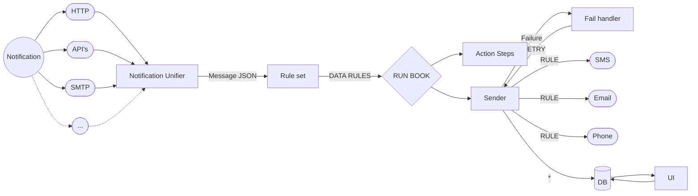

# Diagram architektury

Diagram odtworzony ze zdjęcia tablicy (`917423941_1492683679378398_2501446404069057702_n.jpg`).

## Otwarte pytania (z tablicy)

1. Jak przychodzą Notifications? (chyba tak)
2. Czy w wiadomości jest informacja, czy coś jest pilne?

## Status (z tablicy)

- [x] Did 1
- [x] Did 2
- [ ] Doing 3
