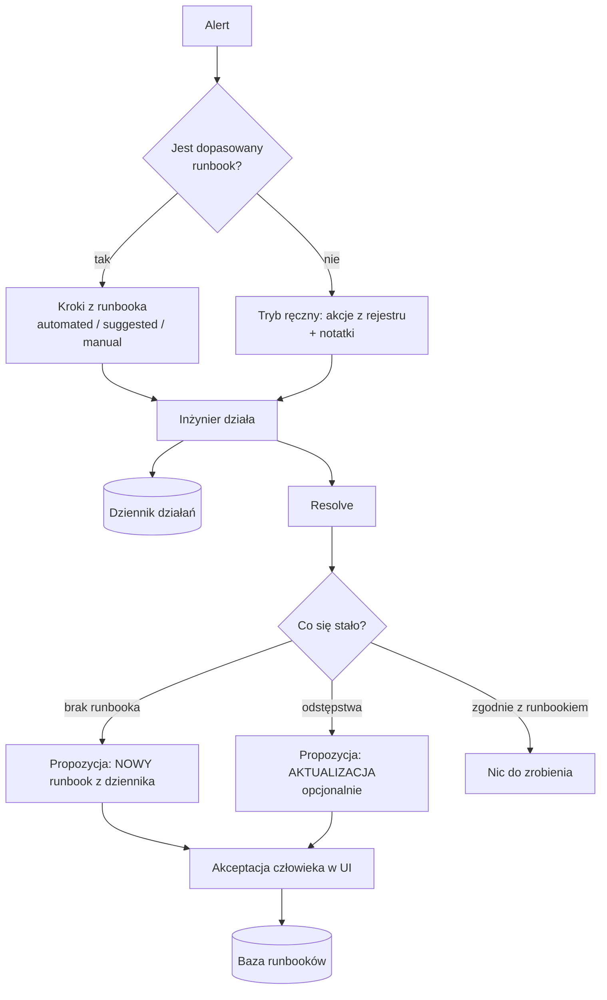

Poniżej pełny, zaktualizowany brief. Najważniejsze zmiany względem poprzedniej wersji:
- **Rejestr akcji ma dwa rodzaje** (kodowe i deklaratywne HTTP), a nieznana akcja degraduje się do kroku ręcznego z licznikiem „nieobsłużonych akcji" i widokiem „Propozycje".
- **Alert bez runbooka** ma widok ręcznych akcji z notatkami, a uczenie z incydentu jest rozpisane na 3 przypadki (w MVP tylko przypadek 1).
- Poprawiono schemat uczenia (wynik trafia do akceptacji człowieka), kryteria akceptacji i scenariusz demo.

````markdown
# Brief dla agenta: Runbook Forge (alerting + runbooki na hackathon)

## 0. Jak używać tego dokumentu
Jesteś agentem implementującym projekt na firmowy hackathon. Ten dokument to pełny kontekst: cel, wymagania, ustalenia projektowe, architektura, zakres, kolejność prac i kryteria akceptacji. Gdy czegoś brakuje, wybierz najprostsze rozwiązanie zgodne z dokumentem, zapisz decyzję w `docs/DECISIONS.md` i jedź dalej. Nie rozszerzaj zakresu poza sekcję 5 bez wyraźnej prośby użytkownika.

## 1. Kontekst
- Firmowy hackathon, zespół 2-4 osób, **18 godzin** pracy.
- Zadanie: **Flexible Alerting & Notification Service** (platforma w stylu PagerDuty): sygnały z logów, brokerów i webhooków są deduplikowane, kierowane do właściwych osób na ich preferowanym kanale i rozwiązywane z pomocą runbooków oraz (częściowo zautomatyzowanych) akcji naprawczych.
- Podstawą oceny jest **wideo do 5 min**. Kryteria: Flexibility, Scalability, UX, Throughput/Latency (**zmierzone**, ze skryptem testu i wynikami), Level of implementation (repo + README + opis mocków), Innovation, Presentation. Finał: top 5 zespołów na żywo + Q&A.
- Jury przyniesie na demo **nieznany schemat zdarzenia** i **nieznany runbook** (możliwe, że z akcją, której nie mamy). System musi sobie z nimi poradzić bez zmian w kodzie.
- Jeśli używane są narzędzia AI, trzeba opisać w zgłoszeniu, jak (i jak zaadresowano bezpieczeństwo/prywatność).

## 2. Pomysł: Runbook Forge
**Jedno zdanie:** platforma alertingowa, w której runbook w dowolnym formacie (YAML, Markdown, wolny tekst) zamienia się w ustrukturyzowane kroki z bramkami zatwierdzeń, a system uczy się nowych runbooków z tego, co zespół faktycznie zrobił przy incydencie.

**Wyróżnik (to ma być „wow"):** sekcja 2.6 zadania zrobiona naprawdę dobrze:
1. runbooki w dowolnym formacie, importowane na żywo,
2. **łagodna degradacja**: nieznana akcja nie wywraca systemu, tylko staje się krokiem ręcznym, a akcję można dodać konfiguracją w kilkadziesiąt sekund,
3. **uczenie z incydentów**: wiedza z ręcznie rozwiązanych incydentów zamienia się w runbooki,
na tle solidnego rdzenia (ingest → reguły → dedup → dostarczanie).

## 3. Wymagania z zadania (skrót, który obowiązuje)

### 3.1 Ingest
- Minimum **dwa typy źródeł**: HTTP webhook + broker (Redis Streams albo RabbitMQ; domyślnie Redis Streams).
- Różne schematy wiadomości, bez jednego sztywnego formatu. Dodanie źródła/schematu = konfiguracja, nie kod.

### 3.2 Reguły
- Filtry na dowolnym polu (także zagnieżdżonym, np. `error.code`, `payload.notional`), operatory: `eq, ne, in, gt, gte, lt, lte, contains, regex, exists`, łączenie AND/OR (zagnieżdżone).
- Per reguła: routing (kto, jakie kanały), prezentacja (szablony tytułu i treści `{{pole.zagnieżdżone}}`, wybór pól, kolor/severity w UI).
- Tworzenie i zmiana reguł **w runtime** (API + UI), bez restartu.

### 3.3 Dostarczanie
- Kanały: **UI, Email, SMS, telefon**. Zewnętrzne mogą być symulowane (Mailpit dla email, mock dla SMS/telefonu z logiem dostarczeń), ale dodanie realnego dostawcy ma być małą, odizolowaną zmianą (interfejs adaptera).
- Preferencje per zespół/osoba (np. critical → telefon + SMS, warning → email, info → UI). Opcjonalnie godziny pracy.
- Odporność: retry z backoffem, brak utraty alertów przy awarii kanału (kolejka trwała, DLQ), fallback na inny kanał.

### 3.4 UI
- Feed alertów na żywo (push, SSE lub WebSocket), ack/resolve, zarządzanie regułami i preferencjami kanałów, **propozycje poprawek/ulepszeń** (patrz 5.8), prezentacja zgodna z regułą.

### 3.5 Antyspam
- **Dedup**: ten sam błąd 500 razy na minutę = jeden alert z licznikiem. (Grupowanie/throttling: tylko jeśli zostanie czas.)

### 3.6 Runbooki
- Dołączane do reguł, schematów lub typów alertów, w wielu formatach: YAML, Markdown, link (wiki), checklista, wolny tekst.
- Po wywołaniu alertu pokazują się dopasowany runbook i następne kroki z podstawionymi wartościami z wiadomości; pełne kroki w UI i emailu, krótki link w SMS.
- Kroki mogą być akcjami: retry workflow, restart usługi, webhook, ticket, eskalacja do innego zespołu. **Ryzykowne akcje wymagają zatwierdzenia przez człowieka** (UI lub odpowiedź na alert).
- Zapis, co i kto zrobił; zamknięcie alertu, gdy problem zniknie.
- Nowy runbook/typ akcji ma się dodawać tak łatwo jak reguła.
- Opcjonalnie (nasz wyróżnik): automatyczne uczenie runbooka z zapisanych kroków incydentu.

## 4. Dane przykładowe (muszą działać)

### Zdarzenia
```json
// A. Broker: awaria workflow
{"type":"WORKFLOW_FAILED","workflowId":"WF-20261023-00042","workflowName":"order-settlement","step":"validate-counterparty","severity":"ERROR","environment":"prod","timestamp":"2026-10-23T09:14:02.331Z","error":{"code":"TIMEOUT","message":"Counterparty service did not respond in 5000 ms"}}

// B. Webhook: przekroczenie progu metryki (styl Alertmanager)
{"alertname":"HighErrorRate","labels":{"service":"payments-api","region":"eu-west","severity":"critical"},"annotations":{"summary":"Error rate 12% over the last 5 minutes"},"startsAt":"2026-10-23T09:13:00Z","status":"firing"}

// C. Broker: zdarzenie biznesowe z inną kopertą
{"meta":{"schema":"trade.rejected.v2","producer":"trade-gateway","ts":1792833245000},"payload":{"tradeId":"T-998877","desk":"rates","notional":25000000,"currency":"EUR","reason":"LIMIT_BREACH"}}
```

### Przykładowe reguły (dane startowe)
- **Settlements:** `type = WORKFLOW_FAILED AND workflowName = order-settlement AND environment = prod` → telefon (on-call) + SMS; w UI krok i komunikat błędu na czerwono.
- **Pricing:** logi z `pricing-engine-*` na poziomie WARN+ → tylko UI (grupowanie opcjonalne).
- **Rates:** `schema ~ trade.rejected.* AND desk = rates AND notional > 10000000` → email + UI; tytuł `Rejected {{payload.currency}} {{payload.notional}} — {{payload.reason}}`.
- **Anna (osobista):** critical z `payments-api` → SMS w godz. 08:00-20:00, poza nimi email.

### Przykładowe runbooki
```yaml
# YAML (Settlements)
runbook: settlement-timeout
matches: { type: WORKFLOW_FAILED, "error.code": TIMEOUT }
steps:
  - check: "Is counterparty-service healthy?"
    action: http_get
    url: "http://counterparty-service/health"
  - action: retry_workflow
    workflowId: "{{workflowId}}"
    approval: none
  - if: "retry fails twice"
    action: escalate
    team: counterparty-support
    approval: required
```
```markdown
# Markdown (payments)
# HighErrorRate on payments-api
1. Open the payments dashboard and check if errors are in one region only.
2. If one region: fail traffic over to the other region (needs approval from the team lead).
3. If all regions: check the last deployment and roll it back.
4. Post an update in the #payments-incidents channel every 15 minutes.
```
```text
Wolny tekst (pricing): When pricing latency goes over a second, it's usually the cache. Restart the pricing-engine instance named in the alert, wait 2 minutes, and if latency is still high, call the pricing on-call person.
```

## 5. Zakres MVP (18 h)

### Budujemy
1. **Ingest:** endpoint webhook + konsument Redis Streams; normalizacja do modelu kanonicznego przez **mapowania w YAML (JSONPath)** ładowane z bazy/plików, hot reload.
2. **Model kanoniczny alertu:** `id, source, schema, severity, environment, title_hint, fingerprint, fields (oryginał, zagnieżdżony), received_at`. Reguły operują na oryginale + polach kanonicznych.
3. **Dedup:** klucz = hash pól wskazanych w regule/mapowaniu (domyślnie: source+schema+pola identyfikujące), okno w Redisie (`INCR` + TTL), licznik na alercie, bez ponownego powiadamiania w oknie.
4. **Silnik reguł:** AND/OR, zagnieżdżone pola, operatory z 3.2, render szablonów (Jinja2 w sandboxie lub Mustache; bez wykonywania kodu), cache reguł odświeżany po zmianie (pub/sub).
5. **Routing i preferencje:** osoba/zespół → kanały wg severity i godzin; adaptery kanałów: UI (SSE/WS), Email (SMTP → Mailpit), SMS/telefon (mock z logiem w tabeli `deliveries` i widokiem w UI).
6. **Dostarczanie niezawodne:** kolejka w Redis (stream + consumer group), retry z backoffem, DLQ, status dostarczenia w Postgresie, fallback na kolejny kanał.
7. **Runbooki i akcje:**
   - wspólny schemat kroków (sekcja 6),
   - parser YAML (deterministyczny),
   - parser Markdown i wolnego tekstu przez LLM → schemat (walidacja, whitelist akcji, podgląd i akceptacja człowieka; fallback: pokaż jako tekst bez akcji),
   - dopasowanie runbooka do alertu (po regule / `matches`), podstawianie wartości z alertu,
   - **rejestr akcji w dwóch rodzajach** (sekcja 7):
     - *kodowe* (klasa/funkcja): `http_get`, `webhook`, `retry_workflow` (mock endpoint), `restart_service` (mock), `escalate`, `open_ticket` (mock), `notify`,
     - *deklaratywne HTTP* (plik YAML lub formularz w UI, bez kodu i restartu),
   - **bramka zatwierdzeń** (`approval: none|required`), akcje ryzykowne zawsze `required`, zatwierdzenie z UI,
   - **dziennik działań** (kto/co/kiedy/wynik).
8. **Obsługa braków i uczenie się (sekcja 8):** krok z nieznaną akcją → krok ręczny + licznik nieobsłużonych akcji; widok **„Propozycje"**; alert bez runbooka → tryb ręcznych akcji z notatkami; przycisk **„Zapisz jako runbook"** z dziennika incydentu.
9. **UI** (React): feed na żywo, szczegóły alertu z krokami runbooka (status każdego kroku widoczny) i przyciskami, kolejka zatwierdzeń, ack/resolve, edytor reguł (formularz + podgląd JSON, test reguły na przykładowym zdarzeniu), edytor mapowań źródeł, edytor akcji deklaratywnych, import runbooka (wklej → podgląd kroków → zapisz), preferencje kanałów, widok dostarczeń (mock SMS/telefon), widok „Propozycje".
10. **Test obciążenia (k6 lub podobny):** skrypt w repo, pomiar msg/s oraz latencji ingest→dostarczenie (p50/p99), wyniki w `docs/LOADTEST.md`. Zacznij od niego wcześnie (po pierwszym przepływie end-to-end).
11. **Uruchomienie:** `docker compose up` (opcjonalnie `make demo` ładujący dane startowe). Od świeżego klona do działającego dema: maks. 2 komendy.

### Świadomie NIE budujemy
Prawdziwych dostawców SMS/telefonu, harmonogramów on-call, uwierzytelniania poza prostym tokenem API, pełnego grupowania/throttlingu (tylko dedup), multi-tenancy, HA Postgresa/Redisa, automatycznej aktualizacji istniejących runbooków (przypadek 2 z sekcji 8, tylko jeśli zostanie czas).

## 6. Schemat kroku runbooka (wspólny format wewnętrzny)
```yaml
id: settlement-timeout
title: "Settlement timeout"
source_format: yaml|markdown|text
matches: { ...warunki jak w regułach... }
steps:
  - id: s1
    type: check|action|manual|escalate|note
    text: "Opis dla człowieka, może zawierać {{zmienne}}"
    action: http_get            # tylko z rejestru akcji
    params: { url: "http://.../health" }
    approval: none|required
    condition: "opcjonalny opis warunku (tekst lub prosty predykat)"
    automation: automated|suggested|manual   # status widoczny w UI
```
Znaczenie `automation`:
- `automated`: akcja istnieje w rejestrze i jest przypisana jednoznacznie (np. z YAML),
- `suggested`: parser/LLM zaproponował mapowanie na istniejącą akcję, czeka na akceptację człowieka w podglądzie importu,
- `manual`: brak pasującej akcji; krok jest zwykłą instrukcją z przyciskiem „Zrobione" i polem na notatkę.

## 7. Rejestr akcji i obsługa nieznanych akcji

### Dwa rodzaje akcji
1. **Kodowe:** klasa/funkcja z opisem (nazwa, parametry, `risk: low|high`). Dla akcji, które nie są HTTP.
2. **Deklaratywne HTTP:** definicja w YAML lub formularzu UI, ładowana na żywo:
   ```yaml
   action: flush_cache
   kind: http
   method: POST
   url: "http://cache-admin/{{service}}/flush"
   risk: high            # wymusza approval
   ```
   Dodanie takiej akcji nie wymaga zmian w kodzie ani restartu (spełnia wymaganie, że nowa akcja jest tak łatwa jak reguła).

### Co się dzieje przy akcji spoza rejestru
Warstwy od najlepszej do najgorszej:
1. **Dopasowanie do istniejącej akcji** (parser/LLM): propozycja `suggested`, człowiek akceptuje w podglądzie.
2. **Akcja deklaratywna dodana konfiguracją:** po dodaniu kroki tego typu stają się `automated`.
3. **Degradacja do kroku ręcznego (domyślne zachowanie):** `automation: manual`, krok widoczny z oznaczeniem „brak automatyzacji", zapis w dzienniku, kto i kiedy go wykonał.
4. **Sygnał o braku automatyzacji:** licznik `unhandled_actions` (jaka akcja, w jakim runbooku, ile razy wykonana ręcznie) → widok „Propozycje": „Krok *restart pricing-engine* wykonano ręcznie 7 razy, warto dodać akcję".

### Zasady bezpieczeństwa
- **Nigdy nie wykonujemy niczego spoza rejestru.** Brak `shell`, `eval`, wykonywania kodu z treści runbooka; LLM nie może wprowadzić nowego polecenia, tylko wybrać z rejestru.
- Akcje ryzykowne (`risk: high`) zawsze wymagają `approval: required`, niezależnie od treści runbooka lub odpowiedzi LLM.
- Nieznana akcja traktowana jest jak ryzykowna: jeśli runbook sugeruje zatwierdzenie, krok ręczny też je wymaga.
- Odpowiedź LLM z akcją spoza whitelisty jest odrzucana, krok degraduje do `manual`.
- `http_get`/`webhook`/akcje HTTP: allowlista hostów (ochrona przed SSRF), timeouty.

## 8. Uczenie się z incydentów

Alert bez runbooka jest normalną sytuacją, a nie błędem. Jeśli żadna reguła nie ma dopasowanego runbooka, szczegóły alertu pokazują tryb ręczny: możliwość uruchamiania dowolnych akcji z rejestru, pole na notatki i dziennik działań.

Trzy przypadki:
1. **Brak runbooka (MVP, obowiązkowy):** inżynier rozwiązał incydent ręcznie. Po zamknięciu system proponuje „Zapisz jako runbook": generuje runbook (YAML) z dziennika (akcje + notatki jako kroki), ze `matches` wyprowadzonym z pól alertu. Człowiek edytuje i akceptuje; po zapisie ten sam typ alertu ma już kroki.
2. **Runbook istniał, ale inżynier odszedł od niego (opcjonalny, jeśli zostanie czas):** system porównuje dziennik z runbookiem i proponuje aktualizację (np. „dodać krok rollback po kroku 2"). Zawsze za akceptacją człowieka.
3. **Kroki ręczne stają się zautomatyzowane:** po dodaniu akcji deklaratywnej (sekcja 7) kroki `manual` mogą zostać podniesione do `automated` w widoku „Propozycje".

Żaden wynik uczenia nie trafia do bazy runbooków bez akceptacji człowieka.



## 9. Architektura
```
Źródła (webhook, Redis Streams)
  → Ingest/Normalizacja (mapowania YAML+JSONPath)
  → Dedup (Redis, okno + licznik)
  → Silnik reguł (cache z Postgresa, hot reload)
  → Routing + preferencje
  → Kolejka dostarczeń (Redis stream, retry, DLQ)
  → Adaptery kanałów: UI(SSE/WS) | Email(Mailpit) | SMS/telefon(mock)
Silnik reguł → Runbook Forge:
  Parser (YAML / LLM) → Rejestr akcji (kodowe + deklaratywne HTTP)
  → Wykonawca → Bramka zatwierdzeń → Dziennik
  → Uczenie z audytu (nowy runbook) → Akceptacja człowieka → Baza runbooków
  Nieznana akcja → krok manual + licznik unhandled_actions → widok „Propozycje"
Postgres: reguły, mapowania, alerty, runbooki, akcje, dostarczenia, audyt. Redis: dedup, kolejki, pub/sub.
```
Skalowanie: ingest i workery bezstanowe (repliki), stan w Redis/Postgres, konsumenci w grupach. LLM wyłącznie przy imporcie runbooka (poza ścieżką krytyczną).

## 10. Stack (domyślny; zmień tylko z uzasadnieniem w DECISIONS.md)
- Backend: **Python 3.12 + FastAPI** (uvicorn), SQLAlchemy + Alembic, `jsonpath-ng`, Jinja2 w trybie sandbox.
- Redis (dedup, streams, pub/sub), Postgres 16.
- Frontend: React + Vite + TypeScript, SSE.
- Infra: docker compose (api, worker, ingest, redis, postgres, mailpit, ui, mock-targets).
- Testy: pytest (silnik reguł, dedup, parser runbooków, szablony, degradacja nieznanych akcji), k6 (obciążenie).
- LLM: jeden klient za interfejsem `RunbookParser`, konfigurowalny przez zmienne środowiskowe; tryb offline z zapisanymi wynikami (fixtures) jako fallback na demo.

## 11. Układ repo
```
/api        FastAPI: rules, sources, runbooks, actions, alerts, approvals, proposals, SSE
/worker     konsumenci: ingest, rules, delivery, executor
/adapters   channels/ (ui, email, sms_mock, phone_mock), actions/ (kodowe: http_get, webhook, ...)
/ui         React
/config     sources/*.yaml, rules/*.yaml, runbooks/*, actions/*.yaml (deklaratywne), preferences.yaml
/loadtest   k6 script + results
/docs       ARCHITECTURE.md, DECISIONS.md, LOADTEST.md, MOCKS.md
docker-compose.yml, Makefile, README.md
```

## 12. Kolejność prac (milestony)
1. **H0-3:** szkielet, compose, model danych, ingest webhook + normalizacja + 3 przykładowe schematy, zapis alertu.
2. **H3-6:** silnik reguł + szablony + dedup + dostarczanie (UI + Mailpit + mock SMS), SSE feed. **Pierwszy przepływ end-to-end.**
3. **H6-8:** skrypt k6, pierwszy pomiar, poprawa wąskich gardeł.
4. **H8-12:** runbooki: schemat, parser YAML, dopasowanie, podstawianie, rejestr akcji (kodowe + deklaratywne HTTP), degradacja do `manual`, wykonawca, zatwierdzenia, dziennik. Parser LLM dla Markdown/tekstu z podglądem.
5. **H12-15:** UI: edytory reguł/mapowań/akcji/runbooków, kolejka zatwierdzeń, tryb ręczny dla alertu bez runbooka, „Zapisz jako runbook", widok „Propozycje".
6. **H15-17:** retry/DLQ/fallback, broker jako drugie źródło (jeśli jeszcze nie), preferencje i godziny, ostateczny load test.
7. **H17-18:** README, MOCKS.md, nagranie wideo, przejście scenariusza demo 3 razy na czysto sklonowanym repo.

## 13. Kryteria akceptacji
- `docker compose up` + dane startowe → trzy przykładowe zdarzenia z sekcji 4 generują alerty zgodnie z regułami z sekcji 4.
- 500 identycznych zdarzeń w minutę → 1 alert z licznikiem 500, jedno powiadomienie.
- Nowy schemat JSON dodany **wyłącznie przez UI/konfigurację** daje działający alert w < 2 min.
- Wklejony nieznany runbook (Markdown lub wolny tekst) → podgląd kroków ze statusem `automated/suggested/manual` → po akceptacji kroki z podstawionymi wartościami z alertu.
- Runbook z akcją spoza rejestru **nie powoduje błędu**: krok staje się `manual`, licznik `unhandled_actions` rośnie, wpis widać w „Propozycjach".
- Dodanie akcji deklaratywnej HTTP (UI lub YAML) w < 1 min zmienia taki krok z `manual` na `automated` bez restartu i bez zmian w kodzie.
- Niczego spoza rejestru nie da się wykonać (test: runbook z poleceniem shell nie wykonuje niczego).
- Krok z `approval: required` nie wykona się bez zatwierdzenia w UI; wszystko trafia do dziennika.
- Alert bez dopasowanego runbooka pokazuje tryb ręczny; po resolve „Zapisz jako runbook" generuje poprawny runbook YAML z dziennika, a kolejny alert tego typu ma już te kroki.
- Wyłączenie kanału (np. Mailpit) nie gubi alertów: retry, potem fallback/DLQ, widoczne w UI.
- Zmiana reguły w UI działa bez restartu.
- Raport z k6 w repo: msg/s oraz p50/p99 ingest→dostarczenie.
- README: uruchomienie (max 2 komendy), opis architektury, lista mocków, jak dodać źródło/kanał/akcję/runbook.

## 14. Bezpieczeństwo i prywatność (do opisania w zgłoszeniu)
- Do LLM trafia wyłącznie tekst importowanego runbooka (bez danych alertów, sekretów, danych osobowych); w repo tylko dane syntetyczne.
- Whitelist akcji (rejestr), wymuszone zatwierdzenia dla ryzykownych, człowiek akceptuje wynik parsowania i każdy runbook wygenerowany z incydentu.
- `http_get`/`webhook`/akcje deklaratywne: allowlista hostów (SSRF), timeouty, brak wykonywania kodu z runbooków, szablony w sandboxie.
- Sekrety wyłącznie ze zmiennych środowiskowych, nic w repo.
- Opisać w zgłoszeniu, jak użyto narzędzi AI przy tworzeniu kodu.

## 15. Ryzyka i środki zaradcze
- LLM źle sparsuje runbook → walidacja + podgląd + whitelist; fallback na tekst/`manual`.
- LLM niedostępny na demo → fixtures + parser deterministyczny dla YAML.
- Rozrost zakresu → trzymać sekcję 5; przypadek 2 uczenia i grupowanie/throttling tylko po spełnieniu kryteriów akceptacji.
- Brak pomiarów → k6 po pierwszym przepływie end-to-end, LLM poza ścieżką krytyczną.
- Poprawność przy skalowaniu poziomym → cały stan w Redis/Postgres, idempotentne konsumenty (klucz idempotencji = `alert_id + channel`).
- Użytkownicy zakładają, że system coś zrobił, a krok był ręczny → wyraźne oznaczenie statusu `automation` przy każdym kroku w UI, emailu i dzienniku.

## 16. Scenariusz demo (5 min), pod który optymalizujemy
1. (0:30) Problem + jeden slajd architektury.
2. (0:45) Trzy źródła/schematy płyną, reguły działają, dedup pokazuje „×500".
3. (0:45) Alert HighErrorRate: wklejony runbook Markdown → kroki z wartościami; krok ryzykowny czeka na zatwierdzenie.
4. (1:15) **Wow:** jury daje nieznany runbook w wolnym tekście z akcją, której nie mamy. Import działa, krok ląduje jako „ręczny", w „Propozycjach" widać brak. Dodajemy akcję deklaratywną HTTP w ~30 s i ten sam krok staje się zautomatyzowany.
5. (1:00) Alert bez runbooka: rozwiązujemy ręcznie, klik „Zapisz jako runbook", następny alert tego typu ma gotowe kroki.
6. (0:45) Wynik testu k6 (msg/s, p50/p99), co jest zmockowane, podsumowanie.

## 17. Pierwsze polecenie dla agenta
Przeczytaj cały dokument, zaproponuj plan na milestone 1-2 (lista plików i zadań), następnie utwórz szkielet repo z `docker-compose.yml`, modelem danych (z miejscem na `automation` w krokach, tabelą akcji i licznikiem `unhandled_actions`) i działającym przepływem: webhook → normalizacja → dedup → reguła → dostarczenie do UI i Mailpit. Po zakończeniu uruchom testy i pokaż, jak to odpalić jedną komendą.
````